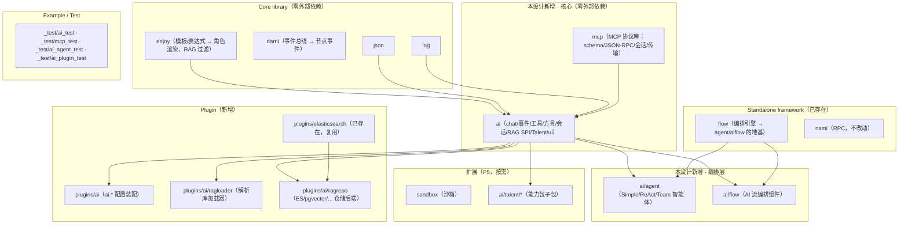

# Solon-AI 迁移到 Go 的设计（ai）：总览

> 本文是「Solon-AI 迁移到 Go」系列的第一篇（总览与可行性）。
> 配套：[`01-go-comparison.md`](01-go-comparison.md)（Java→Go 逐项对照）、[`02-chat-core.md`](02-chat-core.md)（聊天模型核心）、[`03-agent-design.md`](03-agent-design.md)（智能体与流编排）、[`04-mcp-design.md`](04-mcp-design.md)（MCP 协议）、[`05-rag-design.md`](05-rag-design.md)（RAG 检索增强）、[`06-talents-and-extended.md`](06-talents-and-extended.md)（Talents/Sandbox/Harness/Loop/UI/ACP）、[`07-migration-plan.md`](07-migration-plan.md)（迁移步骤与分期路线）。
> 源码参照：`/Users/airhead/WorkSpace/goldsyear/solon-ai`（`org.noear:solon-ai-framework` 4.1.1，git tag `4.1.1`）。
> 目标宿主：`aifei-go` 工作区（Go 1.27，多模块；核心模块零外部依赖）。
>
> 本文**不写实现代码**，只给出：solon-ai 是什么、迁什么不迁什么、概念词典、模块地图、关键设计决策、可行性结论——作为后续逐篇的**契约**。所有设计均为**提案**，供最终审核与逐步调整。

---

## 0. TL;DR（设计摘要）

- **solon-ai 是一个约 39 万行 Java 的全栈 AI 应用框架**，分层清晰：`solon-ai-core`（聊天/嵌入模型抽象 + 消息/事件/工具/会话 + RAG SPI + Talent SPI，28.5K 行）→ 5 个厂商方言（33.4K 行）/ router → `solon-ai-agent`（Simple/ReAct/Team 智能体，**构建在 solon-flow 之上**，39.9K 行）→ `solon-ai-flow`（AI 流编排组件，2.1K 行）/ `solon-ai-mcp` + `mcp-core`（MCP 协议，35K 行）→ talents（18 个能力包，48.8K 行）→ harness / loop（Claude-Code 式编排容器与持久循环引擎，24K 行）；旁支：RAG 三件套（加载器/仓储/搜索，25K 行）、sandbox（10K 行）、ui 流式协议适配（6K 行）、ACP（20.8K 行）。
- **aifei-go 已具备最关键的前置依赖**：`./flow`（solon-flow 的忠实 Go 移植，`NamedTaskComponent`/`GraphSpec`/`Engine.Eval` 与 Java 逐字对应，已核实）可直接承载 `solon-ai-agent` 的 TeamAgent 与 `solon-ai-flow` 的组件模型；`./enjoy` 对标 SnEL 表达式（角色模板渲染、RAG 过滤表达式）；`./dami` 对标 FlowContext 的 EventBus；`./json`/`./log`/`./config`/`./server` 各就其位；`./plugins/elasticsearch` 可直接作 RAG 仓储后端。**solon-ai 中用到的 flow 能力可以直接复用，无需改 flow 的核心语义**（仅一处可选增量：`flow.Node` 的 per-node 附件缓存，见 03）。
- **最大的语言鸿沟是 Reactor**：solon-ai 全线以 `Flux<ChatEvent>`/`Mono` 为公开 API（30 种聊天事件、流式工具递归、MCP/ACP 会话）。**对策**：`context.Context` 取代 `Thread.interrupt` 式取消；**回调 Sink 为主契约**（对齐方言层 `ctx.emit()` 推模型）+ `<-chan ChatEvent` 适配器为人体工学形态；事件模型的不变量（RESPONSE_START/END 各恰好一次、失败时 ERROR 事件与 error 返回双通道且**无** RESPONSE_END、STEP 边界随工具递归递增）原样保留为 Go 契约。
- **nami 现状不满足流式**：`nami/channel/http` 整包 `io.ReadAll` 后才交给 Decoder，`Channel.Call` 是请求/响应形状，且默认 30s 总超时会杀死长流。**对策**：`./ai` 自带一个约百行的轻量 HTTP+SSE 客户端缝（`net/http`，可注入 `*http.Client`），非流式与流式统一走它；nami 保持不动（见 6.2 决策 D2，含备选方案）。
- **反射面用 Go 惯用法替换**：`@ToolMapping` 方法注解 → `reflect` 扫描 + 参数 struct tag 生成 JSON Schema（`server.Register` / dami Lpc 已有同型先例）；`@McpServerEndpoint` → 注册式 API；CRTP 自类型泛型链（`ModelOptionsAmend<T,X>`）→ 每层一个具体 Options 类型 + 链式 setter。
- **MCP 自研而非套用官方 Go SDK**：`mcp-core` 本就是 vendored 的官方 Java SDK fork；Go 侧按本仓库「自包含、零外部依赖」的一贯哲学（dami/flow/nami 先例）**原生实现协议层**（schema + JSON-RPC + 会话 + stdio/Streamable HTTP/SSE 传输），JSON 编解码 SPI 模块（`mcp-json-jackson2`）在 Go 中自然消失（`encoding/json` 即全集）。
- **定位**：新增 `./ai`（核心，零外部依赖）+ `./mcp`（协议库，零外部依赖）+ `./ai/agent`、`./ai/flow`（编排层，依赖 `./flow`）+ `./plugins/ai` 系列（装配与带三方依赖的后端）；填补 aifei-go 在「**LLM 应用 / 智能体编排 / 工具协议 / RAG**」层的空白，与现有 `flow`（编排）、`dami`（事件）、`nami`（RPC）、`db`（持久化）互补成完整栈。
- **工作量预估**：P0–P4 核心路径（chat/流式/方言/agent/MCP/RAG SPI+内置实现）约 **10,000–13,000 行 Go**；P5 扩展（仓储后端/加载器/talents/sandbox/harness/loop）按需追加，全量对齐约 25,000 行级。分期与验收见 [`07-migration-plan.md`](07-migration-plan.md)。

---

## 1. solon-ai 是什么

`solon-ai` 是 Solon 生态的 **Java LLM 应用框架**（自述 "Java LLM(tool, skill) & RAG ... framework"），覆盖从底层模型调用到上层智能体编排的完整链路：

| 能力域 | 说明 | solon-ai 对应模块 |
|--------|------|-------------------|
| 聊天模型 | 统一 ChatModel API + 5 厂商方言（OpenAI/Anthropic/Gemini/Ollama/Dashscope），call/stream 双路径，30 种流式事件 | `solon-ai-core` + `solon-ai-llm-dialects` |
| 工具调用 | FunctionTool + JSON Schema 自动生成 + `@ToolMapping` 反射绑定 + autoToolCall 递归 | `solon-ai-core` |
| 智能体 | Simple（单轮）/ ReAct（推理-行动循环）/ Team（多智能体协作，8 种协议拓扑） | `solon-ai-agent`（**构建于 solon-flow**） |
| AI 流编排 | Dify 式 YAML 低代码编排，AI 能力封装为 flow 节点组件 | `solon-ai-flow` |
| MCP | Model Context Protocol 服务端 + 客户端（stdio/SSE/Streamable HTTP），MCP 工具直接并入函数调用 | `mcp-core` + `solon-ai-mcp` |
| RAG | 文档加载（7 格式）/ 切分（含语义切分）/ 向量仓储（14 后端）/ 网络搜索（3 家） | `solon-ai-core` SPI + 三件套目录 |
| 能力包 | Talents：cli/code/file/web/memory/lsp/mount 等 18 个「工具+指令+准入」包 | `solon-ai-talents` |
| 高级编排 | Harness（Claude-Code 式编码代理容器）/ Loop（持久化可验证任务循环引擎） | `solon-ai-harness` / `solon-ai-loop` |
| 沙箱 | Claude Code `sandbox-runtime` 的 Java 移植（文件/网络/进程隔离） | `solon-ai-sandbox` |
| UI 流协议 | Vercel AI SDK / AG-UI 两种前端流式协议适配 | `solon-ai-ui-*` |
| 编辑器协议 | ACP（Agent Client Protocol，Zed 系） | `acp-*` + `solon-ai-acp` |

### 1.1 模块全景（Java 侧，含规模）

```
solon-ai/                        # 版本 4.1.1（parent: org.noear:solon-parent:4.1.1）
  ├ solon-ai-core/               # 核心：ChatModel/消息/事件/工具/会话/embedding/RAG SPI/Talent（193 文件，28,565 行）
  │   └ 包：ai / ai.chat.{content,dialect,event,interceptor,message,prompt,session,source,talent,tool}
  │            / ai.embedding / ai.generate / ai.reranking / ai.rag.{loader,repository,splitter,util}
  ├ solon-ai-llm-dialects/       # 5 方言（84 文件，33,352 行）：openai 11.1K / anthropic 8.4K
  │   │                           / gemini 7.5K（含 Interactions API）/ dashscope 3.6K / ollama 2.8K
  ├ solon-ai-router/             # 模型路由（17 文件，1,779 行）：RoundRobin/加权/规则/LLM 智能路由
  ├ solon-ai-agent/              # 智能体（226 文件，39,868 行）：simple / react / team(+8 协议) / session / trace
  ├ solon-ai-flow/               # AI 流编排组件（43 文件，2,134 行）：@ChatModel/@VarInput/@ConsoleOutput…
  ├ solon-ai-loop/               # 持久循环引擎（64 文件，16,286 行）：IDLE→…→COMPLETED 状态机 + 质量门禁
  ├ solon-ai-mcp/                # MCP 框架绑定（146 文件，14,256 行）：注解服务端 + McpClientProvider
  ├ mcp-core/                    # MCP 协议 SDK fork（76 文件，20,807 行）：McpSchema/会话/stdio 传输
  ├ mcp-json-jackson2/           # MCP JSON 编解码 SPI 实现（4 文件，312 行）
  ├ solon-ai-rag-loaders/        # 7 加载器（16 文件，1,883 行）：pdf/word/excel/ppt/html/markdown/ddl
  ├ solon-ai-rag-repositorys/    # 14 向量仓储（89 文件，19,864 行）：es/milvus/pgvector/mysql/redis/qdrant…
  ├ solon-ai-rag-searchs/        # 3 网络搜索（24 文件，3,475 行）：tavily/bocha/baidu
  ├ solon-ai-talents/            # 18 能力包（219 文件，48,783 行）：cli/code/web/memory/lsp/mount/gateway…
  ├ solon-ai-sandbox/            # 沙箱（58 文件，10,036 行）：Seatbelt/bubblewrap/WFP + 代理
  ├ solon-ai-harness/            # 编码代理容器（41 文件，7,826 行）：权限/HITL/命令/子代理调度
  ├ solon-ai-ui/                 # 流式协议适配（75 文件，6,025 行）：ui-aisdk / ui-agui
  ├ acp-core/ + acp-annotations/ + acp-agent-support/ + solon-ai-acp/   # ACP（102 文件，20,817 行）
  ├ solon-ai-anp/                # 空占位（README 仅「敬请期待」）
  └ solon-ai/                    # 聚合 starter（无 src/main，纯测试/示例）
```

Java 8 风格代码（无 sealed/record/虚拟线程）；现代异步全靠 **Project Reactor**（`solon-rx` 传递引入）、`CompletableFuture` 与裸线程。HTTP 客户端统一走 `org.noear.solon.net.http.HttpUtils`（Solon 自家阻塞式客户端 SPI，**不是** okhttp 也不是 nami 的对应物）。

### 1.2 与 solon-flow 的耦合面（aifei-go 已解决的部分）

solon-ai 对 solon-flow 的依赖集中在 `solon-ai-agent` 与 `solon-ai-flow`，grep 核实的完整 import 集合为：`Graph, GraphSpec, NodeSpec, LinkSpec, Node, Link, NodeType, FlowEngine, FlowContext, FlowContextInternal, TaskComponent, NamedTaskComponent, Evaluation, FlowDriver, FlowOptions, FlowInterceptor, NodeRecord, Container, ConditionComponent`。具体接缝：

1. **`Agent` 接口 extends `NamedTaskComponent`** —— 每个智能体**就是一个 flow 任务节点**（`name()` + `run(FlowContext, Node)`），可直接丢进图里当节点用。
2. **`TeamAgent` = 图 + 引擎**：`FlowEngine.newInstance(true)` + `Graph.create(traceKey, spec -> protocol.buildGraph(spec))`，执行即 `flowEngine.eval(graph, -1, context, flowOptions)`（-1 = 步数不限）。
3. **协议（Protocol）= 拓扑构建器**：`spec.addStart(...)` / `spec.addActivity(agent)` / `spec.addExclusive(supervisorTask)` / `ns.linkAdd(target, l -> l.when(cond))`，`when` 是基于 `FlowContext` 状态的动态路由边。
4. **`ReActAgent` 不建图**：手写 `while(true)` 的 reason/action 循环，`FlowContext` 纯作共享黑板（get/put/with）。
5. **`solon-ai-flow` 组件 = `TaskComponent`**：`run(FlowContext, Node)`，数据走 `FlowContext.vars()`，节点事件走 `context.eventBus().send(...)`。
6. **一处内部 API 依赖**：`AgentSession` 向下转型 `FlowContextInternal`（实现 pending/stop）——Go 侧无需此类转换（见 03 第 6 节）。

Go 侧 `./flow` 已**逐字对应**上述概念（`flow.NamedTaskComponent` = `TaskComponent + Name() + Title()`，`flow.Create(id, func(*GraphSpec))`，`Engine.Eval/EvalWithSteps`，`Context.Stop()/With/EventBus()`，`Evaluation` 默认 enjoy），因此**这 6 条接缝全部自然落地**；唯一缺口是 `Node.attachment` 公有缓存字段（solon-ai-flow 用它缓存按节点 meta 构建的模型实例），建议作为向后兼容增量补进 flow（见 03 第 7 节）。

---

## 2. 迁移范围：迁什么、不迁什么

### 2.1 迁（P0–P5，详见 [`07-migration-plan.md`](07-migration-plan.md)）

| # | 能力 | 来源模块 | 目标 |
|---|------|----------|------|
| 1 | 消息与内容块：ChatMessage/Role/ContentBlock（文本/图像/音频/视频/资源） | `solon-ai-core` | `./ai` 根包 |
| 2 | 事件模型：ChatEvent 30 型 9 组 + ChatAccumulator + 流式不变量 | `solon-ai-core` | `./ai`（`event` 子域） |
| 3 | 工具调用：FunctionTool/FunctionToolDesc/Schema 生成/ToolProvider/`@ToolMapping` 等价物 | `solon-ai-core` | `./ai`（`tool` 子域） |
| 4 | 聊天模型：ChatModel/ChatRequestDesc/ChatOptions/ChatResponse/call+stream | `solon-ai-core` | `./ai` 根包 |
| 5 | 方言 SPI + 5 方言（openai(+responses)/anthropic/gemini(+interactions)/ollama/dashscope） | `solon-ai-llm-dialects` | `./ai/dialect/*` 子包 |
| 6 | HTTP/SSE 客户端缝（对标 `HttpUtils` + `TextStreamUtil.parseSseStream`） | `solon-ai-core` | `./ai`（`httpx` 内部包） |
| 7 | 会话：ChatSession + InMemory/File | `solon-ai-core` | `./ai`（`session` 子域） |
| 8 | 嵌入/重排/生成模型抽象 + 各自方言 | `solon-ai-core` + dialects | `./ai`（`embedding` 等） |
| 9 | 模型路由：ChatModelRouter + 4 策略 | `solon-ai-router` | `./ai/router` 子包 |
| 10 | 拦截器：ChatInterceptor（onPrepare/interceptCall/interceptStream） | `solon-ai-core` | `./ai`（`interceptor` 子域） |
| 11 | Talent SPI（工具包 + 指令注入 + 准入控制） | `solon-ai-core` | `./ai`（`talent` 子域） |
| 12 | RAG SPI：Document/Loader/Splitter/Repository(+Storable/Lifecycle)/QueryCondition | `solon-ai-core` | `./ai/rag` 子包 |
| 13 | 内置实现：TextLoader/InMemory 仓储/4 切分器/SnEL→enjoy 过滤 | `solon-ai-core` | `./ai/rag` 子包 |
| 14 | 网络搜索即仓储：tavily/bocha/baidu | `solon-ai-rag-searchs` | `./ai/rag/search/*` 子包（零依赖 REST） |
| 15 | 智能体：Simple/ReAct/Team + 8 协议 + 会话/trace/metrics + 5 拦截器（HITL 等） | `solon-ai-agent` | **`./ai/agent` 独立模块**（依赖 flow） |
| 16 | AI 流编排组件：`@ChatModel` 等 12 组件 + 节点事件 + YAML 契约 | `solon-ai-flow` | **`./ai/flow` 独立模块**（依赖 flow） |
| 17 | MCP 协议库：schema/JSON-RPC/会话/client/server/stdio+SSE+Streamable 传输 | `mcp-core` + `solon-ai-mcp` | **`./mcp` 独立模块**（零外部依赖，原生实现） |
| 18 | MCP↔ai 桥：McpClientProvider(=ToolProvider)/McpTalent + 服务端注册 API | `solon-ai-mcp` | `./ai` 的 `ai/mcp` 子包（桥接 `./mcp`） |
| 19 | UI 流协议：Vercel AI SDK 适配（ai-sdk） | `solon-ai-ui-aisdk` | `./ai/ui/aisdk` 子包 |
| 20 | 装配插件：`ai.*` 配置 → 模型注册表 + 默认模型 + 包级默认 | 新增（对标各 plugin 模式） | **`./plugins/ai`** |
| 21 | 文档加载器：text/markdown/html（轻量）+ pdf/word/excel/ppt（三方解析库）+ ddl（复用 `./db`） | `solon-ai-rag-loaders` | **`./plugins/ai/ragloader`**（P4/P5） |
| 22 | 向量仓储后端：Elasticsearch（复用 `./plugins/elasticsearch`）、pgvector/MySQL/MariaDB（复用 `./db`）、Redis（复用 `./plugins/cache` 通道）、Milvus/Qdrant 等 | `solon-ai-rag-repositorys` | **`./plugins/ai/ragrepo`**（P5 按需逐个） |
| 23 | UI 流协议：AG-UI 适配 | `solon-ai-ui-agui` | `./ai/ui/agui`（P5） |
| 24 | Talents 能力包（按价值排序的子集） | `solon-ai-talents` | `./ai/talent/*`（零依赖者）/ `./plugins/ai/talent/*`（带依赖者），P5 逐个 |
| 25 | 沙箱 | `solon-ai-sandbox` | `./sandbox` 独立模块（P5，独立价值高） |

### 2.2 不迁 / 缓迁（明确排除或推迟，供审核取舍）

| # | 项目 | 处置 | 原因 |
|---|------|------|------|
| A | **`solon-ai-anp`** | 不迁 | 空占位（README 仅「敬请期待」），无实现可迁。 |
| B | **`solon-ai` 聚合 starter / `solon-ai-talents` 聚合包** | 不迁 | Java 侧即无 src/main（纯依赖聚合 + 测试示例）；Go 的包级按需 import 天然覆盖其作用。 |
| C | **ACP 全家（acp-core/annotations/agent-support/solon-ai-acp）** | 缓迁（P5 之后按需，架构预留 `./acp` 目录位） | ① 编辑器（Zed 系）场景，与服务端 AI 应用主线关联弱；② 仓库内自标 `@UnstableAcpApi`、承诺随时破坏兼容；③ 体量 20.8K 行且与 MCP 的 JSON-RPC 层同构——真需要时 MCP 层可大量复用，边际成本可控。 |
| D | **`solon-ai-harness` / `solon-ai-loop`** | 缓迁（P5，契约先立） | 依赖 talents 矩阵（cli/code/lsp/memory/mount…）与 sandbox，是「全家桶最后一层」；先把 P0–P4 打牢，harness/loop 作为纯增量随时可加（06 立其契约骨架）。 |
| E | **GraalVM AOT / `META-INF/solon` 自动装配** | 不迁 | Go 静态编译即原生；Solon Plugin SPI → `aifei.Plugin` 命令式装配（既有惯例）。 |
| F | **Reactor 背压/操作符语义** | 以 Go 惯用法替换 | `Flux` 的操作符代数（takeUntil/reduce/concatWith…）不逐个复刻；保留**事件不变量**（这是真正的契约），操作符能力由调用方在 channel/回调上自行组合（02 第 5 节给出映射表）。 |
| G | **`redisx` 直连的 Redis 会话/仓储** | 收口到 `./plugins/cache` 通道 | 本仓库既有哲学：Redis 能力走 cache 插件（jetcache-go/go-redis），不为 ai 单独引入第二套 Redis 客户端（flow 迁移处理 RedisStateRepository 时同款决策）。 |
| H | **`solon-ai-sandbox` 的 Windows 后端（WFP/`srt-win.exe`）** | P5 仅 macOS/Linux | Windows 沙箱依赖外部 exe 与 WFP 驱动，无法自测；先覆盖 darwin（Seatbelt）+ linux（bubblewrap），Windows 留接口。 |
| I | **PDF/PPT/Word/Excel 解析的逐格式对齐** | P5 分批，先 text/markdown/html | Go 生态解析库弱于 Java（POI/Tika/PDFBox 无等价物）；P4 先落零依赖与轻量格式，重格式按 `plugins/ai/ragloader` 逐个引入（`pdfcpu`/`xuri/excelize`/`goquery` 等），TEST.md 矩阵逐项补。 |
| J | **官方 MCP Go SDK 包装方案** | 否决（保留为备选） | `modelcontextprotocol/go-sdk` 尚未 1.0、依赖面不受控；本仓库 dami/flow/nami 均为原生忠实移植，MCP 协议本身规范清晰（JSON-RPC + 三种传输），自研约 2.5K 行即可覆盖（04 论证）。若用户偏好官方 SDK，可改为 `plugins/mcp` 包装——决策 D6 留档。 |

> **结论**：P0–P4 迁完后，aifei-go 拥有「聊天模型 + 方言 + 流式 + 智能体（含多智能体协议）+ AI 流编排 + MCP 双端 + RAG 全 SPI + 内置实现 + 装配」的完整 AI 框架层，对应 solon-ai 的主干与最高频使用面；P5 及之后按真实需求解锁长尾（仓储后端矩阵、talents、sandbox、harness/loop、ACP）。

---

## 3. 概念词典（Java → Go 命名）

> 完整方法签名对照见 [`01-go-comparison.md`](01-go-comparison.md)。

| 中文 | Java 概念 | Java 类型 | Go（建议） | 说明 |
|------|----------|-----------|-----------|------|
| 聊天模型 | 聊天模型 | `ChatModel` | `ai.ChatModel` | 具体类 + 方言 SPI（保持） |
| 聊天请求描述 | 请求描述 | `ChatRequestDesc` | `ai.RequestDesc` | 每次对话的构建器（session/options/call/stream） |
| 聊天响应 | 聚合响应 | `ChatResponse` | `ai.Response` | 不可变快照：内容/思考/工具调用/用量 |
| 聊天消息 | 消息 | `ChatMessage` / `ChatRole` | `ai.Message` / `ai.Role` | system/user/assistant/tool 四角色 |
| 助手消息 | 助手消息 | `AssistantMessage` | `ai.AssistantMessage` | 文本+思考+工具调用+协议状态 |
| 内容块 | 内容块 | `ContentBlock`/`TextBlock`/`ImageBlock`… | `ai.ContentBlock`/`ai.TextBlock`/… | 多模态块 |
| 聊天事件 | 流式事件 | `ChatEvent`/`ChatEventType` | `ai.ChatEvent`/`ai.EventType` | 30 型 9 组，单结构体 + 类型常量 |
| 事件累加器 | 累加器 | `ChatAccumulator` | `ai.Accumulator` | 事件→AssistantMessage 聚合 |
| 流上下文 | 流上下文 | `ChatStreamContext` | `ai.StreamContext` | 方言 emit 入口 + 方言私有状态袋 |
| 函数工具 | 函数工具 | `FunctionTool`/`FunctionToolDesc` | `ai.FunctionTool`/`ai.ToolDesc` | 定义/描述二分（保持） |
| 工具调用 | 工具调用 | `ToolCall`/`ToolResult` | `ai.ToolCall`/`ai.ToolResult` | 模型发起的调用与其结果 |
| 工具提供者 | 工具提供者 | `ToolProvider` | `ai.ToolProvider` | `Tools() []FunctionTool` |
| 方言 | 厂商方言 | `ChatDialect`/`ChatDialectManager` | `ai.Dialect`/`SelectDialect(cfg)` | 请求构建 + 响应解析（事件先行） |
| 会话 | 会话 | `ChatSession` | `ai.Session` | 消息历史窗口 |
| 能力包 | 天赋/技能包 | `Talent` | `ai.Talent` | 工具+指令+准入三合一 |
| 提示 | 提示 | `Prompt` | `ai.Prompt` | 消息集合 + attrs |
| 用量 | 用量 | `AiUsage` | `ai.Usage` | token 计量 |
| 模型路由 | 路由器 | `ChatModelRouter`/`RoutingStrategy` | `ai/router.Router`/`Strategy` | N 模型择一 |
| 智能体 | 智能体 | `Agent<Req,Resp>` | `agent.Agent`（非泛型小接口） | **= flow.NamedTaskComponent** |
| 智能体请求 | — | `AgentRequest`/`AgentResponse` | `agent.Request`/`agent.Response`（各具体类型） | CRTP 消解（01 第 4 节） |
| 智能体会话 | — | `AgentSession` | `agent.Session` | ChatSession + pending + flow 上下文快照 |
| 团队协议 | — | `TeamProtocol` | `agent.Protocol` | 4 阶段生命周期 SPI |
| 智能体事件 | — | `AgentEvent`（~20 类） | `agent.Event`（单结构体 + 类型常量） | Run/Reason/ToolCall/Node/Team 事件 |
| AI 流组件 | — | `AiComponent`/`ChatModelCom`… | `aiflow.Component`/`ChatModelCom`… | `@名称` 注册的 TaskComponent |
| MCP 客户端 | — | `McpClientProvider` | `aimcp.ToolProvider`（包 `ai/mcp`） | MCP 工具 → 函数调用桥 |
| MCP 服务端 | — | `McpServerEndpointProvider` | `mcp.Server` + 注册 API | http.Handler / stdio 双形态 |
| 文档 | — | `Document` | `rag.Document` | content + metadata + embedding |
| 切分器 | — | `DocumentSplitter` | `rag.Splitter` | Regex/TokenSize/Json/Semantic |
| 仓储 | — | `Repository`(+Storable/Lifecycle) | `rag.Repository`（能力接口拆分） | 向量/文档存储 |
| 查询条件 | — | `QueryCondition` | `rag.Query` | limit/阈值/新鲜度/过滤表达式（enjoy） |
| 网络搜索 | — | `TavilyWebSearchRepository` 等 | `rag/search.TavilyRepository` 等 | 搜索即仓储 |

**命名策略**（与 aifei-go 既有风格一致）：动作动词沿用 Java 语义（`Call`/`Stream`/`Prompt`/`Embed`/`Eval`）；无参访问器去 `Get` 前缀（`resp.Content()`，对齐 `flow` 的 `node.ID()`/`ctx.Trace()`）；Java 静态工厂 → Go 包级构造（`ai.OfUser("...")`、`ai.NewChatModel(...)`）；泛型方法受限处走包级 helper（`ai.Bind[T]`，对齐 `nami.Result.As[T]` 先例）。

---

## 4. 模块地图与依赖

### 4.1 在 aifei-go 工作区中的位置



> 依赖方向严格单向：`ai` 不依赖 `flow`（编排能力隔离在 `ai/agent`、`ai/flow` 两个独立模块）；`mcp` 不依赖 `ai`（可独立作纯 MCP 工具服务）；桥接单向发生在 `ai` 的子包 `ai/mcp`（import `./mcp`）。

### 4.2 Go 模块与 Java 模块对照

| Go 模块（路径 → module） | 对齐的 Java 模块 | 依赖 | 外部依赖 |
|--------------------------|------------------|------|----------|
| `./ai` → `…/aifei-go/ai` | solon-ai-core + dialects + router + searchs + ui-aisdk | enjoy、json、log、mcp（仅 ai/mcp 子包需要） | **零** |
| `./mcp` → `…/aifei-go/mcp` | mcp-core + mcp-json-jackson2 + solon-ai-mcp 的传输/服务端 | json、log | **零** |
| `./ai/agent` → `…/aifei-go/ai/agent` | solon-ai-agent | ai、flow、enjoy、dami、log | **零** |
| `./ai/flow` → `…/aifei-go/ai/flow` | solon-ai-flow | ai、flow、log | **零** |
| `./plugins/ai` → `…/plugins/ai` | 新增（装配） | aifei、config、ai、log | **零** |
| `./plugins/ai/ragloader` | rag-loaders | ai + 解析库（goldmark/goquery/…按格式）+ db（ddl） | 按格式 |
| `./plugins/ai/ragrepo` | rag-repositorys | ai + plugins/elasticsearch 或 db 或官方 SDK | 按后端 |
| `./sandbox` → `…/aifei-go/sandbox` | solon-ai-sandbox | log | **零** |
| （预留）`./acp` | acp 全家 | acp 核心自足 | P5 后议 |

> **模块粒度原则**（对齐仓库惯例）：核心与协议层保持零外部依赖、独立可发布；凡引入三方库（解析器/向量库 SDK）一律下沉 plugins，且尽量复用既有插件（elasticsearch/cache）与核心库（db）。

### 4.3 go.mod（建议，以 `./ai` 为例）

```
module github.com/crazy-airhead/aifei-go/ai
go 1.27
require (
    github.com/crazy-airhead/aifei-go/enjoy v1.0.x
    github.com/crazy-airhead/aifei-go/json v1.0.x
    github.com/crazy-airhead/aifei-go/log v1.0.x
    github.com/crazy-airhead/aifei-go/mcp v0.0.x   // 仅 ai/mcp 子包 import
)
replace (
    github.com/crazy-airhead/aifei-go/enjoy => ../enjoy
    github.com/crazy-airhead/aifei-go/json => ../json
    github.com/crazy-airhead/aifei-go/log => ../log
    github.com/crazy-airhead/aifei-go/mcp => ../mcp
)
```

`go.work` 追加：`use ./ai ./mcp ./ai/agent ./ai/flow ./plugins/ai`（及后续 `./plugins/ai/ragloader`、`./plugins/ai/ragrepo`、`./sandbox`）。测试模块对照仓库约定新建：`_test/ai_test`、`_test/mcp_test`、`_test/ai_agent_test`、`_test/ai_plugin_test`（`use` 同步登记）。

> 多模块发布沿用既有打标签约定（`ai/vX.Y.Z`、`mcp/vX.Y.Z`、`ai/agent/vX.Y.Z`…，推 GitHub 远端触发）。

### 4.4 `./ai` 内部包结构（建议）

| 包 | 职责 | 对应 Java 包 |
|----|------|--------------|
| `ai`（根） | Message/Role/ContentBlock/AssistantMessage、ChatModel/RequestDesc/Response、ChatConfig、Usage、Dialect SPI + 注册选择、Interceptor、Prompt、Session | `ai.chat` + `ai.chat.{message,content,interceptor,prompt,session}` |
| `ai`（根，`event` 域） | ChatEvent/EventType/EventGroup/Accumulator/StreamContext/EventFilter | `ai.chat.event` |
| `ai`（根，`tool` 域） | FunctionTool/ToolDesc/ToolCall/ToolResult/ToolProvider/Schema 生成/reflect 绑定 | `ai.chat.tool(.impl)` + `ai.annotation` |
| `ai/httpx`（内部） | HTTP 客户端缝 + SSE 解析器（对标 HttpUtils/TextStreamUtil） | `solon-net-httputils` 使用面 |
| `ai/dialect/openai`（+`responses`）、`anthropic`、`gemini`（+`interactions`）、`ollama`、`dashscope` | 5 方言 | `ai.llm.dialect.*` |
| `ai/embedding`、`ai/rerank`、`ai/generate` | 嵌入/重排/生成模型 + 方言 | `ai.embedding` 等 |
| `ai/router` | 模型路由 | `solon-ai-router` |
| `ai/session` | InMemory/File 会话 | `ai.chat.session` |
| `ai/talent` | Talent SPI | `ai.chat.talent` |
| `ai/rag` | Document/Loader/Splitter/Repository/Query + InMemory + 切分器 | `ai.rag(.*)` |
| `ai/rag/search` | tavily/bocha/baidu | `rag-searchs` |
| `ai/mcp` | MCP→ToolProvider 桥（McpClientProvider 等价物） | `solon-ai-mcp` client 侧 |
| `ai/ui/aisdk`（+ P5 `agui`） | ChatEvent → Vercel AI SDK SSE parts | `solon-ai-ui-aisdk` |

---

## 5. 与 aifei-go 现有能力的关系（不重复造轮子）

| solon-ai 依赖 | aifei-go 对应 | 复用方式 |
|-----------------|--------------|----------|
| `solon-flow`（Graph/GraphSpec/Node/FlowEngine/FlowContext/NamedTaskComponent/Evaluation） | **`./flow`**（已核实逐字对应：`flow.Create`、`GraphSpec.AddActivityNamed`、`Engine.Eval*`、`Context.Stop/With/EventBus`、`Evaluation` 默认 enjoy） | `ai/agent`、`ai/flow` 直接构建其上；TeamAgent 的图构建/求值/拦截器/无限步数全部现成 |
| liquor SnEL（`roleFor` 模板渲染、`when:` 条件、RAG `filterExpression`） | **`./enjoy`** 表达式/模板引擎 | 角色与系统提示按 `Context.vars()` 渲染；RAG 过滤表达式经 enjoy 求值（对标 SnEL `Expression<Boolean>`） |
| `FlowContext.eventBus()`（DamiBus，节点事件 `flow.node.start/end`） | **`./dami`**（`flow.Context.EventBus() *dami.Bus` 懒初始化，已存在） | `ai/flow` 组件沿用同一事件契约（话题名保持 `flow.node.start`/`flow.node.end`） |
| `HttpUtils`（阻塞 HTTP + SSE 流读取） | **`./ai/httpx` 新增**（nami 不满足流式，见 D2） | 非流式调用可选经 nami，但主路径统一 httpx |
| snack4 `ONode` / Jackson 双栈 + `McpJsonMapper` SPI | **`./json`**（encoding/json 封装） | 三处 JSON 栈统一为一处；`mcp-json-jackson2` 模块消失 |
| snakeyaml（frontmatter/链配置） | `gopkg.in/yaml.v3`（config 已用） | agent 定义（harness）与链 YAML |
| `@Configuration`/Plugin SPI/META-INF 自动装配 | **`aifei.Plugin`** + `config.Props` + 命令式装配 | `plugins/ai` 读 `ai.*`（对照 storage/cache/kafka 插件模式） |
| Solon Web SSE / RxEntity（服务端 SSE 流） | **`net/http` Flush + `text/event-stream`**；经 `server.WithHTTPHandler` 裸通道挂载（**swagger 先例**：`plugins/swagger` 的 `Handler() func(http.Handler) http.Handler`） | MCP 服务端（POST/GET/DELETE 原生语义）与聊天 SSE 端点都绕开 `{code,msg,data}` 信封 |
| redisx（会话/仓储 Redis） | **`./plugins/cache`** | Redis 会话/仓储走 cache 通道（G 项决策） |
| —（无对应） | **`./plugins/elasticsearch`**（`Client.Search/Index/BulkIndex` 已抽象 `map[string]any` 查询） | RAG 的 ES 仓储后端直接复用，仅需实现 `rag.Repository` 适配（05 第 6 节） |
| —（无对应） | **`./db`**（database/sql + 方言） | DDL 加载器、pgvector/MySQL 向量仓储（`db.Dao`/`db.SQL`）、text2sql talent |
| slf4j | **`./log`** | 全线 |

---

## 6. 关键设计决策速览（各篇展开论证）

| # | 决策 | 结论 | 详述 |
|---|------|------|------|
| D1 | **流式 API 形态** | 回调 Sink 为主契约（`Stream(ctx, func(*ChatEvent) error) error`），channel 适配器（`StreamChan(ctx)`）为辅；事件不变量原样保留 | 02 第 4 节 |
| D2 | **HTTP 层归属** | `./ai` 自带轻量 HTTP+SSE 缝（`httpx`，可注入 `*http.Client`）；**不改 nami**（`Channel.Call` 请求/响应形状 + 整包缓冲 + 30s 总超时不适配长流）；后续若需要可另立 `nami/channel/sse` 扩展，与本设计正交 | 02 第 3 节 |
| D3 | **方言事件先行契约** | 沿用 v4.1 设计：方言不返回结果、只 `ctx.Emit(ChatEvent)`；call 与 stream、全部厂商统一走同一条事件管线再聚合。这是 solon-ai 4.1 最重要的架构资产，**原样保留** | 02 第 6 节 |
| D4 | **反射工具绑定** | `@ToolMapping` → `ai.RegisterTools(providerStruct)`：reflect 扫描导出方法 + 参数 struct tag（`param:"名称,required" desc:"..."`）生成 JSON Schema；主路径仍是显式 `ai.NewTool(...)` 链式定义（`server.Register`/dami Lpc 同型先例） | 02 第 7 节 |
| D5 | **CRTP 泛型链消解** | `ModelOptionsAmend<T,X>` 家族 → 每层一个具体 Options 类型（`ai.ChatOptions`/`agent.ReActOptions`/`agent.TeamOptions`）+ 链式 setter + `Raw map[string]any` 逃生舱；`Agent<Req,Resp>` → 最小 `agent.Agent` 接口（flow 集成）+ 各具体类型的 Request/Response | 01 第 4 节 |
| D6 | **MCP 自研 vs 官方 SDK** | 自研（`./mcp`，零外部依赖，约 2.5K 行覆盖协议+传输+双端）；理由：仓库自包含哲学 + 官方 Go SDK 未 1.0。备选（包装官方 SDK 为 `plugins/mcp`）留档 | 04 第 2 节 |
| D7 | **`AgentSession` 的 FlowContextInternal 依赖** | Go 侧 `flow.Context` 即我方接口：pending 语义直接用 `Context.Stop()` + 会话内标志实现，**无需任何 flow 内部 API**；快照 = `Context.ToJSON()`（已有） | 03 第 6 节 |
| D8 | **`node.attachment` 缓存** | **已定稿**（2026-10-08 审核，方案 A）：为 `flow.Node` 增加向后兼容的附件缓存 `Attachment/SetAttachment`（并发安全，序列化忽略），对齐 dataisolate 给 db 加 5 项增量的先例；组件内 `sync.Map` 的方案 B 降为文档备选 | 03 第 7 节 |
| D9 | **options 形态** | Java 的全 `Map<String,Object>` options（弱类型字符串键）→ Go 强类型 `Options` struct（常用字段显式）+ `Raw map[string]any`（厂商逃生舱）；方言的 `PrepareOutputFormatOptions` 仍可读写 Raw | 02 第 8 节 |
| D10 | **dual 事件层** | ChatEvent（30 型）与 AgentEvent（~20 类）保持两层分离（Java 同构）；映射代码集中在各 agent 的 ReasonTask/转发处，不散落 | 03 第 5 节 |
| D11 | **取消模型** | `Thread.interrupt` → `context.Context` 贯穿方言 HTTP、工具执行、智能体循环、MCP 会话；SSE 读取尊重 ctx（`http.NewRequestWithContext`） | 01 第 3 节 |
| D12 | **协议状态袋** | `AssistantMessage.protocolStates`（Anthropic 思考签名、OpenAI snapshot 态）→ Go 显式 `ProtocolStates map[string]any`，随消息序列化存活于工具循环 | 02 第 2 节 |

---

## 7. 可行性结论

- **可迁**：solon-ai 主干（chat/方言/流式/工具/agent/flow 组件/MCP/RAG SPI）在 Go 中可达**语义等价**；最重的前置依赖（solon-flow）已经以 `./flow` 存在且 API 逐字对应，这是本次迁移相比「从零迁 solon-ai」最大的红利。
- **语言鸿沟全部有解**：Reactor → ctx + Sink/channel（保不变量）；反射注解 → reflect + struct tag（仓库已有先例）；CRTP → 具体类型；双 JSON 栈 → `./json`；Redis → cache 插件。
- **收益**：aifei-go 补齐 AI 应用层后，「Just Service + 流程编排 + 智能体 + 工具协议 + RAG」形成闭环；agent 与 flow 同源（都坐在 `./flow` 上），与 Java 侧架构演进方向一致。
- **风险**：①**流式语义保真**——SSE 解析边界（CRLF/`[DONE]`/多 choice snapshot 归一化）与事件不变量必须以对照测试固化（Java 侧测试用例直接搬译）；②**方言矩阵长尾**——5 家厂商 ×（chat/embedding/rerank/generate）组合多，P0 只保 openai/ollama 全绿，其余渐进（07 分期细化）；③**Go 解析生态缺口**——pdf/ppt/word 无 Tika 级等价物，P5 分批引入并降级预期；④**MCP 协议版本追踪**——自研需跟随 spec 演进（锁定 2025-06-18 为基线，2025-11-25 的 Form/Url elicitation 标记为扩展位）。
- **工作量预估**（含与实现 1:1 的测试）：

| 阶段 | 内容 | 预估 Go 行数 |
|------|------|--------------|
| P0 | 消息/事件/工具/openai(call)/会话 | 2,200–2,800 |
| P1 | stream + 4 方言 + embedding + router + 拦截器 + ui/aisdk | 2,500–3,200 |
| P2 | agent（Simple/ReAct/Team+协议）+ ai/flow 组件 | 2,300–3,000 |
| P3 | ./mcp 协议 + client/server + ai 桥 | 2,000–2,600 |
| P4 | RAG SPI + 内置实现 + searchs + plugins/ai 装配 | 1,200–1,600 |
| P5（按需） | 仓储后端/加载器/talents/sandbox/harness/loop/agui/ACP | 视范围，全量对齐约再 +12,000 |

---

## 8. 阅读路线

1. 本篇（总览 + 范围 + 概念 + 决策索引）。
2. [`01-go-comparison.md`](01-go-comparison.md)：语言机制逐项对照、命名策略、API 对照速查。
3. [`02-chat-core.md`](02-chat-core.md)：消息/事件/工具/模型/方言/SSE 客户端层的 Go 契约。
4. [`03-agent-design.md`](03-agent-design.md)：智能体三形态 + 团队协议 + 与 `./flow` 的精确接缝。
5. [`04-mcp-design.md`](04-mcp-design.md)：MCP 协议库的分层、传输与 aifei 挂载。
6. [`05-rag-design.md`](05-rag-design.md)：RAG SPI、内置实现与后端矩阵。
7. [`06-talents-and-extended.md`](06-talents-and-extended.md)：Talent SPI、能力包优先级、sandbox/harness/loop/ui/ACP 取舍。
8. [`07-migration-plan.md`](07-migration-plan.md)：分期路线、每期测试用例、验收清单、提交粒度与起步卡。
