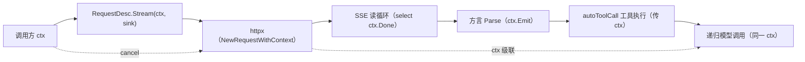

# Java → Go 逐项对照（ai）

> 本文是「Solon-AI 迁移到 Go」系列的第二篇（语言与机制对照）。
> 前置：[`00-overview.md`](00-overview.md)。源码参照：`/Users/airhead/WorkSpace/goldsyear/solon-ai`（4.1.1）。
> 本文回答：solon-ai 用到的每一类 Java 机制，在 Go 侧用什么等价物；公开 API 如何重命名。逐方法签名对照放在各设计篇（02–06），本文是总纲与速查。

---

## 0. TL;DR

- solon-ai 是 **Java 8 风格 + Project Reactor** 代码：无 sealed/record/虚拟线程，无模式匹配重负；真正的迁移成本集中在**四件事**——①Reactor 流（`Flux<ChatEvent>` 为公开 API）②反射注解（`@ToolMapping`/`@McpServerEndpoint`）③CRTP 自类型泛型链（`ModelOptionsAmend<T,X>`、`Agent<Req,Resp>`）④双 JSON 栈（snack4/Jackson）。
- 四件事的 Go 对策全部有仓库内先例：①回调 Sink + channel（dami `StreamSink` 先例）②reflect + struct tag（`server.Register`、dami Lpc 先例）③每层具体类型 + 链式 setter（flow/nami 先例）④统一 `./json`。
- **保留的是语义契约，不是语法形状**：事件不变量、网关默认值、`@/#/$` 派发、协议状态袋这些「行为」逐字保留；「写法」（builder 链、泛型自类型、操作符代数）按 Go 惯用法重写。

---

## 1. 语言机制总对照

| # | Java 机制 | solon-ai 中的用法 | Go 对策 | 仓库先例 |
|---|-----------|-------------------|---------|----------|
| 1 | `Flux<T>` / `FluxSink` | `ChatRequestDesc.stream()`、`AgentRequest.stream()`、MCP/ACP 会话、UI 适配、工具异步结果 | **回调 Sink 主契约** `Stream(ctx, func(*ChatEvent) error) error`；**channel 适配** `StreamChan(ctx) (<-chan *ChatEvent, error)`；内部取消经 `ctx` | dami `StreamSink[R]{Next/Complete}` + `chan StreamItem[R]` |
| 2 | `Mono<T>` | MCP/ACP 的单值异步（大量 `.block()` 落地） | 直接 `func(...) (T, error)` 同步签名；确需异步由调用方 `go` + channel 包裹 | nami `Channel.Call` 同步形状 |
| 3 | `CompletableFuture` | `callAsync()`、`handleAsync`、`supplyAsync` | `go` + channel 的轻量 `Future[T]`（仅 agent `CallAsync` 需要，直接复用 dami `Future[R]` 形状） | dami `Future[R].Get/Done/Then` |
| 4 | `Thread.interrupt`（`sink.onCancel(currentThread::interrupt)`） | 流取消、HTTP 中断、工具中断 | `context.Context` 全链贯穿：`NewRequestWithContext`、SSE 读循环 `select ctx.Done()`、工具循环检查 | Go 标准 |
| 5 | `Disposable.Composite` | SSE 订阅 + 工具递归子流的生命周期归并 | 每层 Stream 返回 error 终结；子流生命周期挂在父 ctx（cancel 即级联） | — |
| 6 | 方法注解 + 反射（`@ToolMapping`/`@ResourceMapping`/`@PromptMapping`） | 工具/资源/提示的方法级声明 | `ai.RegisterTools(struct)` reflect 扫描导出方法；参数 schema 从**参数 struct 的字段 tag** 生成（Go 方法无注解，tag 落在参数类型上） | `server.Register` 方法→路由反射、dami Lpc `RegisterProvider` |
| 7 | CRTP 自类型（`ModelOptionsAmend<T extends ModelOptionsAmend,X>`） | ChatOptions/ReActOptions/TeamOptions 共享链式 API 且返回子类型 | 每层**独立具体类型**复制少量 setter（可嵌入共享 `BaseOptions`）；不追求类型级链式延续 | flow Options、nami Builder |
| 8 | `Agent<Req extends AgentRequest<Req,Resp>, Resp>` | 三种 agent 各有 Request/Response 且接口方法需返回子类型 | 最小 `agent.Agent` 接口（Name/Role/flow 集成）；`Prompt(...)` 等返回具体类型的方法定义在**具体 agent 类型**上（`*SimpleAgent.Prompt(...) *SimpleRequest`） | — |
| 9 | 接口默认方法（`Talent`/`TeamProtocol`/`ChatInterceptor` 大量 default） | 可选实现的宽接口 | 小接口 + 可嵌入 **base struct**（`ProtocolBase`/`TalentBase` 提供默认实现，嵌入者按需覆写） | flow `SimpleDriver` 嵌 `AbstractDriver` |
| 10 | `@FunctionalInterface` SAM | `ToolHandler`/`RoutingStrategy`/`DocumentSplitter`… | Go func 类型或单方法接口（`type ToolHandler func(args map[string]any) (any, error)`） | flow `TaskFunc`/`ConditionFunc` |
| 11 | 静态工厂（`ChatModel.of(...)`/`Prompt.of(...)`/`TextBlock.of(...)`） | 全线 | 包级构造函数（`ai.NewChatModel(...)`/`ai.OfUser(...)`/`ai.TextBlock(...)`） | flow `flow.Create` |
| 12 | `ServiceLoader` SPI（McpJsonMapper/JsonSchemaValidator） | 可插拔 JSON 编解码 | Go 中无意义（encoding/json 即全集），**整层删除**；将来需要时用 `Register(name, factory)` 注册表（nami Manager 先例） | nami `RegChannel/RegEncoder` |
| 13 | Lombok（@Data/@Builder） | 全线 DTO | 手写 struct + 链式 setter（`func (o *Options) Temperature(v float64) *Options`） | 仓库惯例 |
| 14 | 受检异常 + `throws Throwable`（工具执行） | `FunctionTool.handle` | `error` 返回；工具 panic 由调用侧 `recover` 收敛为 error（`ToolResult.Error(msg)`） | server `Recover()` 中间件思想 |
| 15 | `Map<String,Object>` 弱类型 options（字符串键常量） | `ModelOptionsAmend.options` | 强类型字段 + `Raw map[string]any` 逃生舱（D9） | — |
| 16 | `instanceof` 模式（事件/内容块分发） | `switch(getGroup())` + instanceof | type switch（`switch b := blk.(type)`）；内容块多态经 `Kind() string` + 类型断言 | — |
| 17 | `volatile`/`ConcurrentHashMap`/`AtomicInteger` | 会话表、路由游标、缓存 | `atomic.Bool/Int64`、`sync.RWMutex` + map；MCP 会话表 `sync.Map`（动态键集） | config/flow 同款 |
| 18 | `ExecutorService`（并行网关扇出） | flow driver | Go 侧已在 `./flow` 内解决（goroutine + 首错优先） | flow 现状 |
| 19 | `Thread.sleep` 轮询（loop 引擎心跳/重试） | SimpleLoopEngine、MCP 心跳退避 | `time.Ticker`/`time.After` + ctx；重试退避用 `Restarting` 小工具（或内联） | — |
| 20 | GraalVM AOT 资源注册 | mcp-core/aot | 删除（Go 静态编译） | — |

---

## 2. 流式语义：不变量与操作符映射

### 2.1 必须逐字保留的不变量（契约级，测试固化）

来自 `ChatRequestDesc` javadoc 与 `docs/chat-event-model.md`：

1. `RESPONSE_START` 与 `RESPONSE_END` **各恰好一次**，且 START 先于一切内容事件。
2. `STEP_START`/`STEP_END` 按**模型调用次数**成对出现——autoToolCall 的工具递归每多一轮模型调用，步数 +1（`event.Step()` 递增）。
3. **失败双通道**：产生 `ERROR` 事件**并且**流以 error 终结（Go：sink 返回/通道携带）；失败后**不再有** `RESPONSE_END`。
4. `RESPONSE_END` 是**唯一**携带完整聚合（`Response`/`AssistantMessage`/`Usage`）的事件；中途事件上的快照字段不保证完整。
5. 事件**单线程顺序**投递（Java 侧 Flux 串行语义）；Go 侧同一流内 sink 回调不在多 goroutine 并发进入。
6. `TEXT_START/DELTA/END`、`THINKING_*`、`TOOL_CALL_*` 按 index/itemId 配对；方言负责把厂商增量归一化成该形状（含 OpenAI 的 snapshot 式 delta 重建、Anthropic 的 input_json_delta 拼接）。

### 2.2 Reactor 操作符 → Go 惯用法

| Reactor 用法（solon-ai 实际代码） | Go 等价物 |
|----------------------------------|-----------|
| `stream().filter(ev -> ev.is(TEXT_DELTA)).map(ChatEvent::getText)` | 回调内 `if ev.Is(ai.EventTextDelta) { s += ev.Text() }`；channel 形态配 `for ev := range ch` |
| `.takeUntil(...)` / 计数截断 | 回调返回哨兵 error（`ai.ErrStop`）或 `ctx` cancel |
| `.reduce(ChatAccumulator::new, ChatAccumulator::merge)` | `ai.Accumulate(ctx, req)` 帮助函数（内部即 call 路径的聚合器） |
| `Flux.defer`（订阅时才构建） | Go 回调本身就是惰性执行体（`Stream` 被调用时才开始请求），无需对应物 |
| `Flux.create(sink -> {...})` + `onCancel` | `Stream(ctx, sink)`；ctx 即取消通道 |
| `concatWith`（工具递归子流拼接） | 聚合器在同一 sink 上顺序重放子流事件（`RequestDescDefault.doStream` 的 Go 版职责） |
| `Flux.fromIterable(...)` | 循环投递 |
| `.block()` / `blockLast()` | 同步 `Call()` / `Stream` 直接返回 |

> **明确不复刻**：背压（FluxSink OverflowStrategy.BUFFER → Go 无界 channel 有风险，故主契约选回调——由消费方自律；channel 适配器固定小缓冲 + 满则阻塞生产者，即天然背压）、操作符代数（调用方自行组合）。

---

## 3. 取消与并发模型



- **一条 ctx 贯穿到底**：HTTP 请求、SSE 读、事件投递、工具执行、工具内再发起的模型调用、MCP 调用。任何一层 cancel，全链在下一个边界退出并按不变量 3 收尾（发 `ERROR` 事件 + 返回 `ctx.Err()` 包装）。
- 并发点收敛为三处，全部有既有模式：并行网关（flow 已解决）、TeamAgent 多 agent 节点（flow 引擎调度）、agent `CallAsync`（`go` + dami `Future` 形状）。
- MCP/ACP 会话的 pending-reply 表：`map[requestID]chan reply` + `sync.RWMutex`；超时用 `context.WithTimeout` 包在请求侧（Java 侧 MonoSink.timeout 的等价物）。

---

## 4. CRTP 与泛型的消解（D5/D7）

### 4.1 `ModelOptionsAmend<T,X>` 家族

Java 用 CRTP 让 ChatOptions/ReActOptions/TeamOptions 共享 `temperature()/maxTokens()/toolAdd()` 等链式方法且返回各自类型。Go 对策：

```
ai.BaseOptions            // 共享字段与 setter（Temperature/TopP/MaxTokens/Raw/Tools/Talents…）
  ├ ai.ChatOptions        // 嵌入 + chat 专属（role/instruction/systemPrompt/outputSchema/autoToolCall）
  ├ agent.ReActOptions    // 嵌入 + maxTurns/autoRethink/feedbackMode/planningMode
  └ agent.TeamOptions     // 嵌入 + protocol/traceKey/graphAdjuster
```

嵌入带来的「setter 返回基类型」断裂用**每层薄包装 setter** 解决（仅暴露高频几个），其余经 `Raw` 或直接字段访问。对照 Java 的字段清单见 02 第 8 节。

### 4.2 `Agent<Req,Resp>`

```
agent.Agent（接口，窄）
  Name() string / Title() string            ← NamedTaskComponent
  Run(ctx flow.Context, node *flow.Node) error  ← 默认实现（会话装载/协议注入/trace/节点事件）
  Role() string / RoleFor(ctx) string / Profile() *Profile

*agent.SimpleAgent                          // 具体类型上定义富 API
  Prompt(p *ai.Prompt) *SimpleRequest
*agent.ReActAgent
  Prompt(p *ai.Prompt) *ReActRequest
*agent.TeamAgent
  Prompt(p *ai.Prompt) *TeamRequest

SimpleRequest / ReActRequest / TeamRequest  // 各自 Session(...)/Call()/Stream(ctx,...)/CallAsync()
  → 共同嵌入 agent.RequestBase（session/拦截器/ctx 公共部分）
```

接口只承担「放进 flow 图当节点」这一多态需求；请求/响应的富 API 留在具体类型上，避免 Go 泛型做不了 CRTP 的问题。

---

## 5. 反射与注解扫描（D4）

| Java 声明 | Go 等价写法 |
|-----------|-------------|
| `@ToolMapping(name="queryOrder", description="查询订单")` 标在方法上 | `ai.RegisterTools(&OrderTools{})` 扫描导出方法；方法名 → 工具名（kebab 化，`server.Register` 路由同规则），或经**方法集接口** `ToolNamer` 显式指定 |
| 方法参数的 schema 推导（`ToolSchemaUtil.buildInputParams` 反射 `java.lang.reflect.Type` + `@Param`） | 参数为**单个 struct** 时读字段 tag：`OrderID string \`param:"orderId,required" desc:"订单号"\``；非 struct 参数退化为 `{arg0: typeof}` |
| `resultConverter`（工具结果→ContentBlock 转换） | `ToolDesc.ResultConverter func(any) (any, error)` 函数字段 |
| `@ResourceMapping(uri=...)` / `@PromptMapping`（MCP 服务端） | `mcp.RegisterResource(srv, uri, name, fn)` / `mcp.RegisterPrompt(srv, name, fn)` 显式注册；struct 扫描为可选糖（P3-b 再定） |
| `binding(Map)`（SnEL 模板变量注入工具描述） | 描述字符串经 enjoy 渲染（`ai.RenderDesc(tpl, vars)`），或注册时闭包生成 |

**JSON Schema 生成器**（`ToolSchemaUtil` 的 Go 版，约 200 行）：reflect 遍历 struct 字段 tag → draft-07 schema（type/required/description/format/enum）；`map[string]any`→`object` 无属性；`json.RawMessage`→透传；扩展点保留为包级 `SchemaNodeDescriber func(reflect.Type, *Node)` 钩子（对标 `addNodeDescribe`）。

---

## 6. JSON 栈统一与多态

| Java | Go |
|------|-----|
| snack4 `ONode` 动态树（方言请求构建、UI parts 写出、协议状态） | `map[string]any` + `./json`（构建请求体用 map 保证键序无关；需要稳定输出处用 struct） |
| Jackson 注解多态（`@JsonTypeInfo(property="type")` 内容块/JSONRPC 消息判别） | 自定义 `UnmarshalJSON`：先解 `{"type": ...}` 再分发（`ai.ContentBlock`、`mcp.JSONRPCMessage`、`mcp.Content` 三处同型判别器） |
| `McpJsonMapper`/`AcpJsonMapper` SPI + `mcp-json-jackson2` 模块 | 删除；`encoding/json` 直用。保留 `mcp.UnmarshalMessage([]byte) (Message, error)` 这类入口函数作为「SPI 位」 |
| ONode `serialize`（schema 重序列化缓存） | `json.Marshal(map[string]any)` |
| snakeyaml（agent 定义 frontmatter、链 YAML） | `yaml.v3`（config 已传递依赖） |

---

## 7. API 对照速查（名字级）

### 7.1 chat 核心（solon-ai-core → ./ai）

| Java | Go |
|------|-----|
| `ChatModel.of(apiUrl).apiKey(k).model(m).build()` | `ai.NewChatModel(ai.Config{APIURL: u, APIKey: k, Model: m})`（或 `ai.NewChatModelURL(u)` + 链式） |
| `chatModel.prompt("你好")` | `model.Prompt("你好") *ai.RequestDesc` |
| `req.session(s).options(o -> o.temperature(0.7)).call()` | `req.Session(s).Options(func(o *ai.ChatOptions){ o.Temperature(0.7) }).Call() (*ai.Response, error)` |
| `req.stream()` → `Flux<ChatEvent>` | `req.Stream(ctx, sink)` / `req.StreamChan(ctx)` |
| `resp.getContent()/getText()/getThinking()/getToolCalls()/getUsage()/getFinishReason()` | `resp.Content()/Text()/Thinking()/ToolCalls()/Usage()/FinishReason()` |
| `ChatMessage.ofUser("...") / ofSystem / ofAssistant / ofTool(content,name,id)` | `ai.OfUser("...") / ai.OfSystem / ai.OfAssistant / ai.OfTool(...)` |
| `TextBlock.of(s) / ImageBlock.ofUrl(u) / ofBase64(b)` | `ai.TextBlock(s) / ai.ImageBlockOfURL(u) / ai.ImageBlockOfBase64(b)` |
| `ChatEvent.is(TEXT_DELTA) / isGroup(TEXT) / getText()` | `ev.Is(ai.EventTextDelta) / ev.IsGroup(ai.GroupText) / ev.Text()` |
| `FunctionToolDesc` + `paramAdd` + `doHandle` | `ai.NewTool("name").Desc(...).Param(...).Handler(fn)` |
| `chatModel.prompt(p).options(o->o.toolAdd(provider).autoToolCall(true))` | `req.Options(func(o *ai.ChatOptions){ o.ToolAdd(provider); b:=true; o.AutoToolCall=&b })` |
| `ChatDialectManager.select(config)` | `ai.SelectDialect(&cfg) Dialect` |
| `InMemoryChatSession.of(id)` | `ai.NewMemorySession(id)` |
| `chatModel.prompt(p).stream()` 聚合 | `ai.CallStream(ctx, req) (*ai.Response, error)`（= stream + Accumulate） |

### 7.2 agent（solon-ai-agent → ./ai/agent）

| Java | Go |
|------|-----|
| `ReActAgent.of(chatModel).maxTurns(8).defaultToolAdd(tools).build()` | `agent.NewReAct(model).MaxTurns(8).ToolAdd(tools).Build()` |
| `agent.prompt("...").session(s).call()` | `ag.Prompt("...").Session(s).Call() (*agent.ReActResponse, error)` |
| `agent.prompt("...").stream()` | `ag.Prompt("...").Stream(ctx, sink)`（`*agent.Event`） |
| `TeamAgent.of(cfg).protocol(HierarchicalProtocol.of()).agents(a,b).build()` | `agent.NewTeam(cfg).Protocol(agent.Hierarchical()).Agents(a, b).Build()` |
| `protocol.buildGraph(spec)` | `Protocol.BuildGraph(spec *flow.GraphSpec)` |
| `session.pending(true, "wait user")` | `session.Pending(true, "wait user")`（内部 `flow.Context.Stop()`） |
| `InMemoryAgentSession.of(id)` | `agent.NewMemorySession(id)` |
| `AgentTrace / Metrics` | `agent.Trace / Metrics`（`AddUsage`/`Snapshot`/`DeltaSince`） |

### 7.3 flow 组件（solon-ai-flow → ./ai/flow）

| Java | Go |
|------|-----|
| `@Component("ChatModel") ChatModelCom` + YAML `task: "@ChatModel"` | `aiflow.ChatModelCom`（实现 `flow.NamedTaskComponent`）+ 组件注册表（`@名称` 派发走 flow 现有 `Container`） |
| `context.eventBus().send("flow.node.start", NodeEvent)` | `ctx.EventBus()`（dami）同话题发送 |
| `node.attachment = chatModel`（缓存） | `node.Attachment(key, val)`（D8 增量，已定稿方案 A） |

### 7.4 MCP（→ ./mcp + ai/mcp）

| Java | Go |
|------|-----|
| `McpClientProvider.builder().url(u).channel("streamable").build()` | `aimcp.NewProvider(mcp.DialHTTP(ctx, u))` |
| `provider.getTools()` → 并入函数调用 | `provider.Tools() []ai.FunctionTool`（`ai.ToolProvider` 实现） |
| `@McpServerEndpoint(channel="streamable", mcpEndpoint="/mcp")` + `@ToolMapping` | `srv := mcp.NewServer(); srv.Tool("name", schema, handler); http.Handle("/mcp", srv.Handler())`（或经 `plugins/ai` 配置装配） |
| `McpAsyncClient.callTool/listTools` | `client.CallTool(ctx, name, args)` / `client.ListTools(ctx, cursor)` |
| `StdioClientTransport(ServerParameters)` | `mcp.DialStdio(ctx, cmd, args...)` |

### 7.5 RAG（→ ./ai/rag）

| Java | Go |
|------|-----|
| `Document.of(content).metadata(...)` / `loader.load()` | `rag.NewDocument(content)` + `rag.Meta(...)` / `loader.Load(ctx)` |
| `splitter.split(docs)` | `splitter.Split(ctx, docs)` |
| `repository.search(query)` / `search(QueryCondition)` | `repo.Search(ctx, query string)` / `repo.SearchQuery(ctx, q *rag.Query)` |
| `repositoryStorable.save(docs)` / `deleteById(ids)` | `storer.Save(ctx, docs)` / `storer.DeleteByID(ctx, ids...)`（能力接口拆分，见 05） |
| `embeddingModel.embed("text")` / `embed(docs)` | `emb.Embed(ctx, "text") ([]float32, error)` / `emb.EmbedDocs(ctx, docs)` |
| `repository.promptAugment(q)` | `rag.PromptAugment(ctx, repo, q) *ai.Message` |

---

## 8. 测试对照策略

| Java 测试资产 | Go 去处 |
|---------------|---------|
| `solon-ai` 聚合模块的 `features/ai/*`（方言对照、流式断言） | `_test/ai_test`：httptest 假服务回放固定 JSON/SSE 片段（不依赖真实厂商；真实联调用环境变量开关，对照 cache/kafka 测试的嵌入依赖哲学） |
| `solon-ai-agent` 的 ReAct/Team 特性测试 | `_test/ai_agent_test`：stub ChatModel（实现 `ai.Dialect` 或注入假 `ChatModel`）驱动 reason/action 循环与协议拓扑 |
| `solon-ai-mcp` 集成测试 | `_test/mcp_test`：in-process client↔server（stdio 子进程 + httptest 双形态） |
| flow 图 YAML 用例（`chat_case1.chain.yml`） | `_test/ai_agent_test`：字面量 YAML 走 `flow.GraphFromText` |
| `TEST.md` 的加载器/仓储矩阵 | `_test/ai_plugin_test`：sqlite（db）+ 内存 ES stub 按后端逐个补 |

---

## 9. 已知不对齐项（显式记录，防隐性漂移）

1. **事件 30 型的 `RAW`/`CUSTOM`/`SERVER_TOOL_*`**：P0 只实现高频 22 型（LIFECYCLE/STEP/TEXT/THINKING/TOOL_CALL/USAGE/ERROR），媒体与安全组（MEDIA_*/REFUSAL/CONTENT_FILTER）随方言补齐——常量全集一次定义齐，避免编号漂移。
2. **`getFrameRaw()`（原始帧）**：Go 侧保留 `Response.Raw() json.RawMessage`，但流中每事件不保留原始帧（内存代价）；`ChatEvent.Raw` 仅在 `EventRaw` 型事件上有值。
3. **Java 的 `ChatResponse.getEvents()`（call 路径保留全事件轨迹）**：保留（`Response.Events()`），代价与 Java 相同。
4. **`thinking` 字段**：Java 区分 `getThinking()`（推理文本）与 `isThinkingOnly()`；Go `AssistantMessage.Thinking string` + `ThinkingOnly() bool`，语义一致。
5. **`session.removeLatestMessage(n)`** 等小众 API：接口从简，P0 不进接口；`Session` 以「消息窗口 + attrs」最小面起步，缺的按需补（对照 config 模块的增补节奏）。
