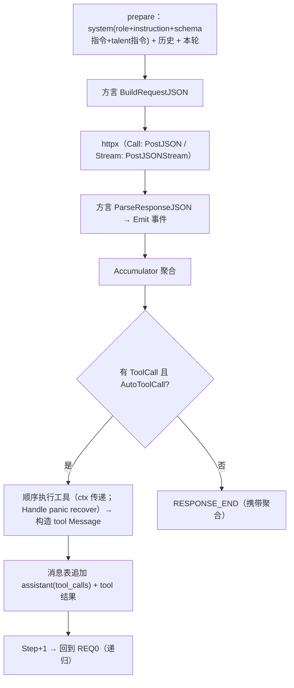

# 聊天模型核心设计（ai）

> 本文是「Solon-AI 迁移到 Go」系列的第三篇（chat 核心）。
> 前置：[`00-overview.md`](00-overview.md)、[`01-go-comparison.md`](01-go-comparison.md)。
> 覆盖：`solon-ai-core` 的 chat 域（消息/事件/工具/模型/方言/会话/拦截器）+ HTTP/SSE 客户端层 + 5 方言的接入契约。
> 本文给出的 Go 签名是**契约级**（实现时可加私有细节，不可改公开语义）。

---

## 0. TL;DR

- 四个层次的流水线：**Message（说什么）→ ChatModel（谁来说）→ Dialect（怎么翻译成厂商协议）→ 事件管线（怎么回来）**。v4.1 的「方言只 `Emit`、不返回」事件先行架构是本篇最核心的保留项（D3）——它让 call/stream、全部厂商、工具递归统一走一条管线。
- 流式双形态：`Stream(ctx, sink)` 回调主契约 + `StreamChan(ctx)` channel 适配（D1）；HTTP 层自研 `httpx`（D2，nami 不动）；工具绑定 reflect + struct tag（D4）；options 强类型 + Raw 逃生舱（D9）。

---

## 1. 包布局与依赖方向

```
ai/                          # 模块根 = 包 ai
  ├ message.go              # Message/Role/AssistantMessage/Prompt
  ├ content.go              # ContentBlock 家族（Text/Image/Audio/Video/Blob/Resource）
  ├ model.go                # ChatModel/Config/RequestDesc/Response
  ├ options.go              # BaseOptions/ChatOptions
  ├ usage.go                # Usage
  ├ event.go                # ChatEvent/EventType（30 常量）/EventGroup
  ├ accumulator.go          # Accumulator（事件 → AssistantMessage/Response 聚合）
  ├ stream_context.go       # StreamContext（方言 emit 入口 + 私有状态袋）
  ├ dialect.go              # Dialect SPI + RegisterDialect/SelectDialect
  ├ interceptor.go          # ChatInterceptor + 调用链
  ├ session.go              # Session 接口 + MemorySession/FileSession
  ├ tool.go                 # FunctionTool/ToolDesc/ToolCall/ToolResult/ToolProvider
  ├ tool_schema.go          # reflect → JSON Schema 生成器
  ├ tool_reflect.go         # RegisterTools(struct) 扫描绑定
  ├ talent.go               # Talent SPI + TalentBase
  ├ httpx/                  # （内部包）HTTP 客户端缝 + SSE 解析器
  ├ dialect/openai/         # + openai/responses、anthropic、gemini(+interactions)、ollama、dashscope
  ├ embedding/ rerank/ generate/   # 同构的另外三类模型
  ├ router/ session/ rag/ rag/search/ mcp/ ui/aisdk/
```

依赖方向：根包互为内聚；`httpx` 只被根包与方言用；方言只 import 根包；`rag`/`router`/`ui` 只 import 根包；`ai/mcp` import `../mcp`。无环。

---

## 2. 消息与内容块

### 2.1 Role 与 Message

```go
type Role string
const (
    RoleSystem    Role = "system"
    RoleUser      Role = "user"
    RoleAssistant Role = "assistant"
    RoleTool      Role = "tool"
)

type Message struct {
    Role     Role
    Content  any              // string 或 []ContentBlock 或 Contents
    CreatedAt *int64           // 毫秒，可空
    Metadata map[string]any
}
func (m *Message) AddMetadata(k string, v any) *Message

// 工厂（对标 ChatMessage.ofXxx 静态族）
func OfUser(content any) *Message            // string | ContentBlock | []ContentBlock
func OfSystem(content string) *Message
func OfSystemRole(role, instruction string) *Message
func OfAssistant(content string) *Message
func OfAssistantBlocks(blocks []ContentBlock) *Message
func OfTool(result *ToolResult, name, callID string, returnDirect bool) *Message
func OfUserAugment(query string, docs any) *Message   // RAG 增强提示（rag 篇展开）
func (m *Message) Clone() *Message                      // 深拷贝（协议 copy() 规则）
```

序列化（会话持久化用）：`MarshalJSON/UnmarshalJSON` 全字段；大块二进制（base64 > 64KiB）降级为占位 metadata（对标 `SESSION_INLINE_BASE64_MAX_CHARS`）。

### 2.2 ContentBlock（多模态）

```go
type ContentBlock interface {
    Kind() string                 // "text" | "image" | "audio" | "video" | "blob" | "resource" | ...
    Metas() map[string]any
    MimeType() string
    Content() any                  // string / []byte / url
}
// 实现（值类型 + 包级构造）：
func TextBlock(s string) TextBlock
func ImageBlockOfURL(u string, mime ...string) ImageBlock
func ImageBlockOfBase64(b []byte, mime ...string) ImageBlock
func AudioBlockOfURL / AudioBlockOfBase64 / VideoBlockOf... / BlobBlockOf... 
type ResourceLink struct{ Name, URI string; ... }

// 多模态容器（对标 Contents）
type Contents struct{ /* texts + blocks */ }
func (c *Contents) AddText(s string) *Contents
func (c *Contents) AddBlock(b ContentBlock) *Contents
func (c *Contents) IsMultiModal() bool
```

反序列化判别：`UnmarshalJSON` 按 `"type"` 字段分发（01 第 6 节同型判别器）。

### 2.3 AssistantMessage 与协议状态袋（D12）

```go
type AssistantMessage struct {
    Text           string
    Thinking       string              // 推理文本（extended thinking）
    ToolCalls      []ToolCall
    Blocks         []ContentBlock
    SearchResults  []SearchResult      // 深度研究/服务端工具结果（P1 随方言补）
    Citations      []Citation
    ProtocolStates map[string]any      // 厂商往返状态：anthropic 思考签名、openai snapshot 态
    Metadata       map[string]any
}
func Snapshot(text string, thinking string, calls []ToolCall, ...) *AssistantMessage  // 对标 AssistantMessage.snapshot
func Bind[T any](m *AssistantMessage) (T, error)     // 结构化输出：文本 JSON → T（包级泛型，nami.As[T] 先例）
func (m *AssistantMessage) HasThinking() bool
func (m *AssistantMessage) ThinkingOnly() bool
```

> `ProtocolStates` 必须随消息进出会话与工具循环**原样回传**（Anthropic/Gemini 的多轮工具调用正确性依赖它）。Java 侧 `docs/assistant-message-protocol-state-migration.md` 的分层（语义层 vs 协议重放层）原样采纳。

### 2.4 Prompt

```go
type Prompt struct{ /* messages + attrs */ }
func NewPrompt(msgs ...*Message) *Prompt
func PromptOf(content string) *Prompt
func (p *Prompt) Attrs() map[string]any              // 显式路由（router ATTR_ROUTE_ID）等
func (p *Prompt) LastMessage() *Message
func (p *Prompt) Copy() *Prompt                       // copy-before-mutate 规则（协议层强制）
```

---

## 3. HTTP/SSE 客户端层（httpx，决策 D2）

### 3.1 为什么不走 nami

| 缺口 | 现状（已核实） | 后果 |
|------|----------------|------|
| 无流式 | `nami/channel/http` 以 `io.ReadAll` 整包读入后才构造 `Result` | SSE 增量永远拿不到 |
| 契约形状 | `Channel.Call(ctx *Context) (*Result, error)` 是请求/响应一次性的 | 塞流式需要破坏性改接口 |
| 总超时 | 默认 `http.Client{Timeout: 30s}` 覆盖整个请求生命周期 | 长对话流会被腰斩（流式只能用拨号级超时） |
| ctx 传递 | `http.NewRequest` 未 `WithContext` | 取消不传导 |

**结论**：`./ai` 自带 `httpx`（内部包，不导出到公开 API 面），形状即 `net/http` 的薄封装：

```go
package httpx
type Doer interface { Do(*http.Request) (*http.Response, error) }   // 默认 &http.Client{}；可注入

type Client struct{ /* doer、超时（拨号/TLS/头，总超时按调用粒度由 ctx 控制）、代理、默认头 */ }
func New(opts ...Option) *Client        // WithDoer/WithTimeout/WithProxy/WithHeader/WithUserAgent

// 非流式：POST JSON，读全文
func (c *Client) PostJSON(ctx context.Context, url string, body []byte, header map[string]string) ([]byte, int, error)

// 流式：POST JSON，回调逐 SSE 事件（data:/event:/id: 行、空行分帧、[DONE] 哨兵、非 2xx 透传 body）
func (c *Client) PostJSONStream(ctx context.Context, url string, body []byte, header map[string]string,
    onEvent func(event, data string) error) error
```

SSE 解析器（对标 `TextStreamUtil.parseSseStream`）：`bufio.Scanner`（放大 buffer 上限 1MiB）按行状态机；`data:` 多行拼接；`event:` 归一化小写；忽略注释行；`[DONE]` 返回哨兵；**读循环每帧检查 `ctx.Done()`**。HTTP/2 与分块编码由 net/http 透明处理。

> 备选方案留档：为 nami 增加 `channel/sse`（`CallStream(ctx, sink)` 新接口 + 懒 body Result）。收益（RPC 面统一）不抵成本（契约分裂 + Filter/Decoder 语义不适配 token 流）；若未来 nami 原生支持流式，`httpx` 可整体改嫁而不动上层（Doer 缝即隔离层）。

### 3.2 代理与鉴权

`ai.Config` 携带 `APIKey/Headers/UserAgent/Timeout/Proxy`；`httpx.Client` 按 Config 构建（方言的 `createHttpUtils` 等价物）。`Options.HTTPCustomize`（对标 `httpCustomizeAdd`）以 `func(*http.Request)` 钩子在每请求前回调。

---

## 4. 流式 API 形态（决策 D1）

```go
// 主契约：回调 Sink
type RequestDesc interface {
    Session(s Session) RequestDesc
    Role(role string) RequestDesc
    Instruction(instruction string) RequestDesc
    SystemPrompt(sp string) RequestDesc
    Options(fn func(*ChatOptions)) RequestDesc
    EventFilter(f EventFilter) RequestDesc

    Call() (*Response, error)
    // Stream 启动一次流式请求：sink 顺序收到全部事件；返回 nil 表示按不变量正常终结。
    // sink 返回 error 立即中止（视为消费方取消，不发 ERROR 事件，直接透传该 error）。
    Stream(ctx context.Context, sink ChatSink) error
}

type ChatSink interface{ OnEvent(ev *ChatEvent) error }
type ChatSinkFunc func(ev *ChatEvent) error            // 适配器

// channel 适配（人体工学；缓冲 64，满则阻塞生产者=天然背压；ctx 取消即关闭）
func StreamChan(ctx context.Context, req RequestDesc) (<-chan *ChatEvent, error)

// 聚合帮助（= stream().reduce(acc)）
func CallStream(ctx context.Context, req RequestDesc) (*Response, error)
```

**契约（不变量，测试逐条固化）**：

1. `RESPONSE_START`/`RESPONSE_END` 各一次；失败时**只有** `ERROR` + error 返回，无 `RESPONSE_END`。
2. `STEP_START/STEP_END` 随 autoToolCall 递归每轮模型调用成对递增（`ev.Step()`）。
3. 同一流内 sink 回调串行；返回 error 即消费方中止（等价 Reactor cancel），此时底层 HTTP 即刻随 ctx/中止信号断开。
4. `RESPONSE_END.Response()` 携带完整聚合；等价地，`Call()` 返回的 `Response` 含 `Events()` 全轨迹。
5. `Stream` 内部：SSE 每帧 → 方言 `Parse` → `ctx.Emit` → 事件管线（过滤器→拦截器→sink）。任何一层 error 走统一收尾（ERROR 事件 + return err）。

---

## 5. 事件模型

### 5.1 类型常量（30 型一次定义齐）

```go
type EventGroup uint8   // Lifecycle/Step/Text/Thinking/ToolCall/ServerTool/Media/Safety/Meta
type EventType uint16
const (
    // LIFECYCLE
    EventResponseStart EventType = iota + 1 // 事件组/相位元数据见常量表
    EventResponseStatus; EventResponseHeartbeat; EventResponseEnd; EventAbort
    // STEP
    EventStepStart; EventStepEnd
    // TEXT
    EventTextStart; EventTextDelta; EventTextEnd
    // THINKING
    EventThinkingStart; EventThinkingDelta; EventThinkingEnd
    EventThinkingSignature; EventThinkingRedacted
    // TOOL_CALL
    EventToolCallStart; EventToolCallArgsDelta; EventToolCallEnd; EventToolResult
    // SERVER_TOOL（P1 随方言补）
    EventServerToolStart; EventServerToolArgsDelta; EventServerToolEnd; EventServerToolResult
    // MEDIA / SAFETY
    EventSearchResult; EventCitation; EventMediaPartial; EventMediaDone
    EventRefusalDelta; EventContentFilter
    // META
    EventUsage; EventError; EventRaw; EventCustom
)
func (t EventType) Group() EventGroup
func (t EventType) IsDelta() bool
```

### 5.2 ChatEvent（单结构体，Java 同为宽接口 + 访问器）

```go
type ChatEvent struct {
    Type    EventType
    RawType string            // 厂商原始类型（"content_block_delta" 等）
    SubType string

    ResponseID         string
    ProviderResponseID string
    Step               int
    ItemID             string
    ToolCallID         string
    Index              int

    Text        string        // TEXT/THINKING delta 载荷
    ToolCall    *ToolCall
    Block       ContentBlock
    Citation    *Citation
    SearchResult *SearchResult
    Usage       *Usage
    Err         error         // EventError 载荷
    Raw         json.RawMessage  // 仅 EventRaw
    Attrs       map[string]any

    resp  *Response           // 仅 RESPONSE_END
    msg   *AssistantMessage   // 同上
}
func (e *ChatEvent) Response() *Response
func (e *ChatEvent) Message() *AssistantMessage
func (e *ChatEvent) Is(types ...EventType) bool
func (e *ChatEvent) IsGroup(groups ...EventGroup) bool
```

### 5.3 StreamContext 与 Accumulator

```go
// 方言面向的解析上下文（对标 ChatStreamContext）
type StreamContext struct{ /* config/request 引用 + emit 链 */ }
func (c *StreamContext) Config() *Config
func (c *StreamContext) IsStream() bool
func (c *StreamContext) ResponseID() string
func (c *StreamContext) Step() int
func (c *StreamContext) Accumulator() *Accumulator
func (c *StreamContext) Emit(ev *ChatEvent)                 // 唯一出口（D3）
func (c *StreamContext) Event(t EventType) *EventBuilder    // 构建器糖
func (c *StreamContext) AttrPut(k string, v any)            // 方言私有状态袋（snapshot 归一等）
func (c *StreamContext) AttrAs[T any](k string) (T, bool)   // 包级泛型读取

// 聚合器（对标 ChatAccumulator）：事件流 → AssistantMessage/Usage/ToolCall 完全体
type Accumulator struct{ /* message/usage/events/finishReason/protocolStates */ }
func NewAccumulator() *Accumulator
func (a *Accumulator) Merge(ev *ChatEvent)          // 幂等吸收（对标 merge）
func (a *Accumulator) Message() *AssistantMessage
func (a *Accumulator) BuildResponse(...) *Response
```

---

## 6. 方言 SPI（决策 D3：事件先行）

```go
type Dialect interface {
    Name() string                       // "openai" / "openai-responses" / "anthropic" / ...
    IsDefault() bool                    // openai 补位方言为 true
    Matched(cfg *Config) bool           // 按 provider/standard/apiUrl 前缀判断

    // 请求侧
    BuildRequestJSON(cfg *Config, opts *ChatOptions, msgs []*Message, isStream bool) ([]byte, string, error)
                                        // 返回 body + 最终 URL（含 /chat/completions 等拼接）
    PrepareOutputSchemaInstruction(schema string, sb *strings.Builder)
    PrepareOutputFormatOptions(opts *ChatOptions)
    BuildAssistantToolCallMessage(acc *Accumulator, builders map[string]*ToolCallBuilder) *Message
    BuildAssistantMessageByToolMessages(msg *AssistantMessage, toolMsgs []*Message) *AssistantMessage

    // 响应侧（唯一解析入口，v4.1 契约）
    ParseResponseJSON(ctx *StreamContext, body []byte)   // 只允许经 ctx.Emit 出结果
    ParseAssistantMessage(acc *Accumulator, node any) []*AssistantMessage
}
func RegisterDialect(d Dialect, priority int)             // init() 时各方言包自注册
func SelectDialect(cfg *Config) Dialect                   // 对标 ChatDialectManager.select
```

**注册与选择**：`ai/dialect/openai` 等子包在 `init()` 里 `RegisterDialect`；选择顺序 = 优先级序（standard 精确匹配 > provider 匹配 > openai 补位）。**不使用反射按名加载**（Java `ClassUtil.tryInstance`），Go 由使用方 import 方言包触发注册（数据库驱动惯例）。

**方言实现要点**（对照 Java 侧沉淀，逐方言在实现期展开）：

| 方言 | 关键归一化负担 |
|------|----------------|
| openai（completions） | 多 `choice.index` 的 snapshot 式 delta 重建（Java `SnapshotState` → `StreamContext.AttrPut` 状态袋）；`stream_options.include_usage`；`finish_reason` 归一为 `tool`/`stop` |
| openai-responses | `responses` API 的 item/event 模型（P1 后期） |
| anthropic | 消息签名（`thinking.signature`）；`input_json_delta` 增量拼 args；cache 计量字段 |
| gemini | `thought` 标记；candidate 归一；（interactions API 为 P5 扩展位） |
| ollama | 本地无鉴权；`/api/chat` 的非标准流尾 |
| dashscope | 兼容模式与原生模式头；embedding/rerank/generate 方言共用配置 |

---

## 7. 工具调用（决策 D4）

### 7.1 类型

```go
type FunctionTool interface {
    Name() string
    Title() string
    Description() string
    Meta() map[string]any
    Strict() *bool
    ReturnDirect() bool
    InputSchema() string                  // JSON Schema（draft-07）字符串
    OutputSchema() string
    ReturnType() reflect.Type
    Handle(ctx context.Context, args map[string]any) (any, error)
    Call(ctx context.Context, args map[string]any) *ToolResult   // 包装 Handle，panic → recover → Error
}

// 声明式构建（主路径）
func NewTool(name string) *ToolDesc
func (t *ToolDesc) Title(s string) *ToolDesc
func (t *ToolDesc) Desc(s string) *ToolDesc
func (t *ToolDesc) Param(p ParamSpec) *ToolDesc           // name/type/required/desc/default/format
func (t *ToolDesc) StringParam(name, desc string, required bool) *ToolDesc   // + Int/Float/Bool/Date 同族
func (t *ToolDesc) InputSchemaJSON(s string) *ToolDesc     // 直接给 schema（跳过生成）
func (t *ToolDesc) ReturnDirect(b bool) *ToolDesc
func (t *ToolDesc) ResultConverter(fn func(any) (any, error)) *ToolDesc
func (t *ToolDesc) Handler(fn func(ctx context.Context, args map[string]any) (any, error)) *ToolDesc
func (t *ToolDesc) Build() FunctionTool

type ToolProvider interface{ Tools() []FunctionTool }
type ToolCall struct{ Index string; ID, Name string; ArgumentsStr string; Arguments map[string]any }
type ToolResult struct{ /* = Contents + success/error */ }
func ToolResultOf(s string) *ToolResult
func ToolResultErr(s string) *ToolResult
```

### 7.2 reflect 绑定（`@ToolMapping` 等价物）

```go
// 扫描 provider 的导出方法；方法名 kebab 化为工具名（server.Register 路由同规则）
func RegisterTools(provider any) ToolProvider
// 显式命名/描述：实现接口
type ToolNamer interface { ToolName(method string) (name, desc string, ok bool) }
// 参数 schema：单 struct 参数读字段 tag
//   type QueryArgs struct {
//       OrderID string `param:"orderId,required" desc:"订单号"`
//       TopK    int    `param:"topK" desc:"返回条数" default:"5"`
//   }
//   func (o *OrderTools) QueryOrder(ctx context.Context, a QueryArgs) (string, error)
// 返回值：(T, error) | T | error 三形；error → ToolResultErr（消息前缀 "Error: "，对齐 Java）
```

Schema 生成器规则（`tool_schema.go`，对标 `ToolSchemaUtil`）：string/int/float/bool → 对应 JSON 类型；`time.Time` → `format: date-time`；slice/map → array/object；`json.RawMessage` 透传；嵌入 struct 展开；扩展钩子 `AddNodeDescriber(fn)`。

### 7.3 autoToolCall 递归（call/stream 共用）



- Java 的 `ToolCallOutcome{COMPLETE, RECURSED, COMPLETE_MEMORY_WRITTEN}` 三态保留为内部枚举；`COMPLETE_MEMORY_WRITTEN`（工具结果直接写入会话不再续跑）在 Go 由 `ReturnDirect + session` 组合触发。
- 递归上限：无（与 Java 一致靠 `maxTurns` 类限制在 agent 层）；但 HTTP 错误重试不内置（拦截器/调用方职责）。

---

## 8. Options 形态（决策 D9）

```go
type BaseOptions struct {
    AutoToolCall *bool
    Tools       []FunctionTool
    ToolAdd(provider ToolProvider)                // 方法形式见下
    ToolChoice  string
    Talents     []Talent
    ToolContext map[string]any
    Raw         map[string]any                    // optionSet 逃生舱：厂商任意参数
}
// 常用强类型 setter（链式，返回 *BaseOptions；各层再薄包装返回自身类型）
Temperature(v float64) / TopP(v float64) / MaxTokens(v int64)
ReasoningEffort(s string)     // low|medium|high|max（方言映射表见实现）
Thinking(b bool) / CacheControl(cc CacheControl)
Set(k string, v any)          // Raw 写

type ChatOptions struct {
    BaseOptions
    Role, Instruction, SystemPrompt string
    OutputSchema string                  // JSON Schema 或经 Bind[T] 反推
    Session     Session                  // 仅 RequestDesc 层注入
}
func OutputSchemaOf[T any]() string      // reflect 反推（ToolSchemaUtil.buildOutputSchema 对应物）
```

> Java 的 `Consumer<ChatOptions>` 函数式配置 → Go `Options(func(o *ChatOptions))`（闭包直改字段，惯用且免链式断裂）。

---

## 9. ChatModel / RequestDesc / Response

```go
type Config struct {
    Name, Description string
    APIKey  string
    APIURL  string
    Standard string        // 显式方言名（"openai-completions" 等，可选）
    Provider string        // "openai"/"anthropic"/...（自动匹配）
    Model   string
    ContextLength int
    Headers map[string]string
    UserAgent string
    Timeout time.Duration
    Proxy   string
    DefaultAutoToolCall bool
    DefaultOptions func(*ChatOptions)
    doer    httpx.Doer     // 测试注入缝
}
func (c *Config) StandardOrProvider() string

type ChatModel struct{ /* config + dialect + httpx client */ }
func NewChatModel(cfg Config) *ChatModel
func NewChatModelURL(apiURL string) *ChatModelBuilder        // .APIKey/.Model()/... .Build()
func (m *ChatModel) Dialect() Dialect
func (m *ChatModel) Config() *Config
func (m *ChatModel) Prompt(p any) RequestDesc   // string | *Message | []*Message | *Prompt

type Response struct{ /* 不可变快照 */ }
func (r *Response) Model() string
func (r *Response) Message() *AssistantMessage
func (r *Response) Content() string      // = Message().Text 的便捷
func (r *Response) Text() string
func (r *Response) Thinking() string
func (r *Response) ToolCalls() []ToolCall
func (r *Response) Blocks() []ContentBlock
func (r *Response) FinishReason() string         // "tool" | "stop"
func (r *Response) Usage() *Usage
func (r *Response) Events() []*ChatEvent          // call 路径全轨迹（对标 getEvents）
func (r *Response) Err() error
func (r *Response) IsTerminal() bool
func (r *Response) Raw() json.RawMessage
func Bind[T any](r *Response) (T, error)          // 结构化输出（= Bind(msg)）
```

**Usage**（对标 `AiUsage` 全字段）：prompt/think/completion/total tokens、cacheCreation/Read（含 5m/1h 拆分）、webSearch/Fetch 计数、`Source json.RawMessage`、`CacheRate() float64`。

**拦截器**：

```go
type Interceptor interface {
    OnPrepare(session Session, opts *ChatOptions, p *Prompt, system *strings.Builder)
    InterceptCall(req *CallRequest, chain CallChain) (*Response, error)
    InterceptStream(req *CallRequest, chain StreamChain) error   // StreamChain 即包装 sink 的再入
}
// 工具级拦截（对标 ToolInterceptor）合并入同接口的可选方法组（base struct 提供默认直通）
```

---

## 10. 会话

```go
type Session interface {
    SessionID() string
    Messages() []*Message
    LatestMessages(window int) []*Message
    RemoveLatestMessage(n int)
    AddMessage(msgs ...*Message)
    IsEmpty() bool
    Clear()
    Attrs() map[string]any
}
func NewMemorySession(id ...string) Session        // InMemoryChatSession
func NewFileSession(path string, id ...string) Session  // FileChatSession（原子写、JSON 行）
// Redis 会话：P5 经 plugins/cache 通道（00 §2.2-G）
```

---

## 11. embedding / rerank / generate

三者与 chat 同构（Config + Builder + 方言），契约从简：

```go
package embedding
type Model struct{ /* cfg + dialect + httpx */ }
func New(cfg ai.Config) *Model
func (m *Model) Embed(ctx context.Context, text string) ([]float32, error)
func (m *Model) EmbedDocs(ctx context.Context, docs []*rag.Document) error   // 填 doc.Embedding
func (m *Model) Dimensions() int
func (m *Model) BatchSize() int

type Dialect interface{
    Matched(cfg *ai.Config) bool
    BuildRequestJSON(...) ([]byte, string, error)
    ParseResponseJSON(body []byte) ([][]float32, error)
}
// rerank.Model.Rerank(ctx, query, docs, topN) ([]Scored, error)
// generate.Model（图像/视频）：Generate(ctx, prompt, opts) (*GenResult, error) —— P5（talents/generation 依赖）
```

P1 落 embedding（RAG 前置）+ openai/ollama/dashscope 三家；rerank P4（RepositoryTool 依赖）；generate P5。

---

## 12. 实现顺序建议（对齐 07 的 P0/P1）

1. message/content/prompt（纯类型 + 序列化）→ 2. event/accumulator（纯类型 + 聚合测试）→ 3. tool 家族 + schema 生成 + reflect 绑定 → 4. httpx（含 SSE 解析器独立单测）→ 5. dialect SPI + openai(call) → 6. RequestDesc call 路径 + autoToolCall 递归 + session → 7. stream 路径（不变量测试）→ 8. 其余方言 → 9. embedding/router/interceptor → 10. ui/aisdk。

每步的黑盒测试清单见 [`07-migration-plan.md`](07-migration-plan.md) 对应小节。
