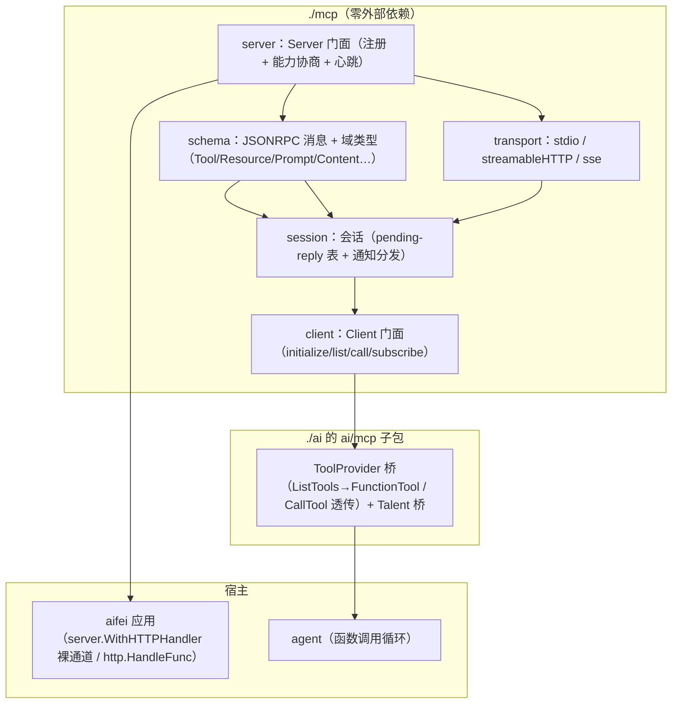

# MCP 协议设计（mcp）

> 本文是「Solon-AI 迁移到 Go」系列的第五篇（Model Context Protocol）。
> 前置：[`00-overview.md`](00-overview.md)、[`01-go-comparison.md`](01-go-comparison.md)、[`02-chat-core.md`](02-chat-core.md)。
> 覆盖：`mcp-core`（vendored 官方 Java SDK fork，20.8K 行）+ `mcp-json-jackson2` + `solon-ai-mcp`（框架绑定，14.3K 行）→ **`./mcp` 独立模块**（协议 + 传输 + 双端）+ **`./ai/mcp` 子包**（ai 桥接）。
> 协议基线：**MCP `2025-06-18`**（含 `2025-03-26` 兼容；`2025-11-25` 的 Form/Url elicitation 作为扩展位，见 §9）。

---

## 0. TL;DR

- Java 侧是「协议 SDK fork（Reactor 全线 Mono/Flux）+ 框架绑定（注解 + Solon 路由器运行时挂载）」两层。Go 侧**重划为三层**：`./mcp`（协议库，零外部依赖，net/http + json）→ `ai/mcp`（桥：MCP 工具 → 函数调用）→ `plugins/ai`（配置装配，05/07 展开）。
- **JSON SPI 模块消失**（`mcp-json-jackson2` 对应物 = `encoding/json`）；**Reactor 消失**（Mono → 同步 error 签名；流式通知 → channel/回调）；**注解消失**（`@McpServerEndpoint`/`@ToolMapping` → 注册式 API，02 已定 D4 方针）。
- 自研论证（D6）：协议本身 = JSON-RPC 2.0 + 三种传输 + 约 40 个域类型，Go 实现约 2.5K 行可控；官方 Go SDK 未 1.0 且依赖面不受控，与本仓库「自包含」哲学冲突。备选（包装官方 SDK 为 `plugins/mcp`）留档待审核翻案。

---

## 1. 分层与模块



包结构：

```
mcp/
  ├ schema.go           # JSONRPCRequest/Notification/Response/Error + 判别反序列化
  ├ types.go            # 域类型：Tool/Resource/Prompt/Content 家族/CallToolResult/…
  ├ version.go          # 协议版本常量与协商
  ├ session.go          # Session（收发 + pending 表）+ 会话管理器
  ├ client.go           # Client + DialHTTP/DialStdio + Options
  ├ server.go           # Server + 注册 API + Handler() http.Handler + Options
  ├ transport_stdio.go  # 子进程 stdin/stdout 行帧
  ├ transport_http.go   # Streamable HTTP（POST/GET/DELETE + Mcp-Session-Id）
  ├ transport_sse.go    # 旧式 HTTP SSE + POST message（2024-11-05 兼容）
  └ util.go             # URI 模板（RFC 6570 子集）/ 工具名校验 / 心跳
```

---

## 2. 决策 D6：自研协议层

| 维度 | 自研（本提案） | 包装官方 Go SDK |
|------|----------------|------------------|
| 依赖 | 零（net/http + encoding/json） | SDK 及其传递依赖（尚在 0.x，API 不稳） |
| 协议覆盖 | 2025-03-26/06-18 全量 + 11-25 扩展位；按需裁剪 | 随官方 |
| 风格契合 | 与 dami/flow/nami 同款「忠实原生移植」 | 引入第二套会话/传输抽象 |
| 工作量 | ~2.5K 行（schema 是大头，纯结构体） | ~0.6K 行包装 |
| 测试 | in-process client↔server 全自控 | 依赖官方行为 |

Java 侧本身就是「fork 官方 SDK 再适配」的先例——证明协议层自持可行且必要（Solon 需要非 Reactor 语义、自己的 HTTP 缝；我们需要非 SDK 的会话形状与零依赖）。**结论：自研；若审核偏好官方 SDK，仅替换 `./mcp` 内部实现，桥与装配层契约不变**（`ai/mcp` 只依赖下述公开面）。

---

## 3. Schema 层

### 3.1 JSON-RPC 帧

```go
type JSONRPCRequest struct {
    JSONRPC string          `json:"jsonrpc"`           // 恒 "2.0"
    ID      any             `json:"id"`                // string | int64（校验：非 float/null）
    Method  string          `json:"method"`
    Params  json.RawMessage `json:"params,omitempty"`
    Meta    map[string]any  `json:"_meta,omitempty"`   // progressToken 在此
}
type JSONRPCNotification struct{ /* jsonrpc + method + params */ }
type JSONRPCResponse struct{ /* jsonrpc + id + result | error */ }
type JSONRPCError struct{ Code int `json:"code"`; Message string; Data any }

func UnmarshalMessage(b []byte) (any, error)   // 判别：method+id→Request；method→Notification；result|error→Response
```

错误码常量：`ParseError -32700 / InvalidRequest -32600 / MethodNotFound -32601 / InvalidParams -32602 / InternalError -32603 / ResourceNotFound -32002`。

### 3.2 域类型（Go struct + json tag，对照 McpSchema）

- 能力协商：`InitializeRequest/Result`、`ClientCapabilities{Roots,Sampling,Elicitation}`、`ServerCapabilities{Tools,Resources,Prompts,Logging,Completion}`、`Implementation`。
- 工具：`Tool{Name,Title,Description,InputSchema,OutputSchema,Annotations *ToolAnnotations}`（`ToolAnnotations`：readOnly/destructive/idempotent/openWorld/returnDirect 提示位）；`CallToolRequest{Name,Arguments}`；`CallToolResult{Content []Content, IsError bool, StructuredContent any}`。
- 资源：`Resource{URI,Name,Title,Description,MimeType,Size}`、`ResourceTemplate{URITemplate,...}`、`ResourceContents`（`TextResourceContents`/`BlobResourceContents`）、List/Read/Subscribe/Unsubscribe 组。
- 提示：`Prompt{Name,Description,Arguments []PromptArgument}`、`GetPromptRequest/Result`、`PromptMessage{Role,Content}`。
- 内容多态（判别 `type`）：`TextContent`、`ImageContent`（base64）、`AudioContent`、`EmbeddedResource`、`ResourceLink`——与 `ai.ContentBlock` 之间在**桥层**互转（§6），协议层不依赖 ai。
- 其它：`SamplingMessage/CreateMessageRequest/Result`（客户端反向采样）、`ElicitRequest/Result`（客户端征询）、`CompleteRequest/Result`、`Root/ListRootsResult`、`ProgressNotification`、`ResourcesUpdatedNotification`、`LoggingMessageNotification`（9 级）、分页 `NextCursor`。

> 形状策略：Java 的 builder + 手写不可变类 → Go 导出 struct（值语义）+ 指针字段表达可选；判别反序列化集中在 `UnmarshalMessage` 与 `UnmarshalContent` 两个入口（01 §6 同型）。

---

## 4. 会话层

```go
type Session struct{ /* transport + 消息泵 + pending 表 */ }
// 核心：
//   sendRequest(ctx, method, params, result any) error
//     · 生成 int64 递增 ID → pending[id] = chan *JSONRPCResponse
//     · 超时 = ctx（调用方 WithTimeout；Java 侧 requestTimeout 的等价物）
//   sendNotification(method, params) error
//   消息泵 goroutine：读 transport 帧 → Response 唤醒 pending / Notification & 服务端请求分发到 handler 表
type HandlerTable struct{ /* method → func(ctx *Ctx, params json.RawMessage) (any, *JSONRPCError) */ }
```

- 客户端会话：`initialize` 握手（版本协商：取 client 支持列表 ∩ server 返回版本，失败按规范回错）+ 变更通知订阅（tools/resources/prompts list changed）。
- 服务端会话：`Mcp-Session-Id` 生成与注销、`notifications/initialized` 标记、GET 流的 Last-Event-ID 恢复位（streamable 传输，§5）。
- **心跳**：客户端 `ping` 定时 + 指数退避（上限 10min，对齐 Java `KeepAliveScheduler`）；服务端 keep-alive 注释帧间隔可配。

---

## 5. 传输层

### 5.1 Streamable HTTP（主传输，2025-03-26+）

```go
// 客户端
func DialHTTP(ctx context.Context, baseURL string, opts ...DialOption) (*Client, error)
//  WithHeaders / WithHTTPClient / WithRequestTimeout / WithHeartbeat / WithProtocolVersions
// 行为：POST JSON-RPC（Accept: application/json, text/event-stream）
//      响应为 SSE 时逐事件解 JSONRPCMessage（服务端可在同一响应流里夹带通知/请求）
//      404/会话失效 → 按规范重建会话重试一次（Java executeWithRetry 对应物）

// 服务端
func (s *Server) Handler() http.Handler
// POST <endpoint>：解帧 → 会话路由 → 处理 → JSON 或 SSE 回写（有服务端→客户端请求时必须 SSE）
// GET  <endpoint>：可选单向 SSE 流（通知/采样/征询下发；Last-Event-ID 恢复）
// DELETE <endpoint>：会话注销
// 头：Mcp-Session-Id（首次响应建立）；405/404 按 spec
```

### 5.2 旧式 HTTP SSE（2024-11-05 兼容）

客户端 GET `<sseEndpoint>` 收 `endpoint` 事件拿 POST 地址，消息走 POST（Java `WebRxSseClientTransport` 对应物）。服务端提供 `SSEHandler(opts)`（`sseEndpoint`/`messageEndpoint` 可配）。P3-c 一起做（与 streamable 共享帧层，增量小），供旧客户端互操作。

### 5.3 stdio

```go
// 客户端：拉起子进程，stdin/stdout 按行帧 JSON-RPC；stderr 透传日志
func DialStdio(ctx context.Context, name string, args ...string) (*Client, error)
// 服务端：从 os.Stdin/os.Stdout 跑会话（命令行工具形态）
func (s *Server) RunStdio(ctx context.Context) error
```

---

## 6. 客户端门面与 ai 桥

```go
type Client struct{ /* session + 缓存 + 心跳 */ }
func (c *Client) Initialize(ctx context.Context) error
func (c *Client) Ping(ctx context.Context) error
func (c *Client) ListTools(ctx context.Context, cursor string) (*ListToolsResult, error)
func (c *Client) CallTool(ctx context.Context, name string, args map[string]any) (*CallToolResult, error)
func (c *Client) ListResources / ListResourceTemplates / ReadResource / SubscribeResource / UnsubscribeResource
func (c *Client) ListPrompts / GetPrompt
func (c *Client) SetLoggingLevel(ctx context.Context, level LogLevel) error
func (c *Client) OnToolsChange(fn func())            // tools/list_changed 订阅
func (c *Client) Close() error
```

**桥（`./ai` 的 `ai/mcp` 包）**：

```go
package aimcp

type ProviderOptions struct{ Allowed, Disallowed []string; CacheTTL time.Duration }
func NewProvider(c *mcp.Client, opts ...ProviderOption) *Provider
func (p *Provider) Tools() []ai.FunctionTool
//   ListTools → ToolDesc：name/title/description/inputSchema/outputSchema/returnDirect 逐字段映射；
//   Handler = CallTool 透传 + Content 映射（TextContent→ai.TextBlock；ImageContent→ImageBlock(base64)；
//   EmbeddedResource/ResourceLink→ResourceLink；IsError → 结果前缀 "Error: "，对齐 Java）
func (p *Provider) ResourceProvider() / PromptProvider()      // 资源/提示桥（agent 直接引用）
func Providers(spec any) *AggProvider                          // mcpServers 配置（Claude-Desktop 格式）聚合
```

桥带游标缓存（默认 30s）+ `executeWithRetry`（传输错误重置会话重连一次，Java 同款）。`McpTalentClient`（Talent 桥）随 P4 talent 体系补（06）。

---

## 7. 服务端门面

```go
type Server struct{ /* 能力 + 注册表 + 传输提供者 */ }
func NewServer(info mcp.Implementation, opts ...ServerOption) *Server
//  WithInstructions / WithCapabilities(...) / WithStrictToolName(false)

// 注册 API（对标 @ToolMapping/@ResourceMapping/@PromptMapping 三注解）
func (s *Server) Tool(name string, schema string, fn func(ctx *CallCtx, args map[string]any) (*CallToolResult, error)) *ToolSpec
//   ToolSpec：Title/Desc/Annotations/OutputSchema/Meta（链式补充）
func (s *Server) Resource(uri, name string, fn func(ctx *CallCtx) ([]Content, error)) *ResourceSpec
func (s *Server) ResourceTemplate(tpl, name string, fn ...)          // RFC 6570 子集展开
func (s *Server) Prompt(name string, args []PromptArgument, fn func(ctx *CallCtx, args map[string]string) (*GetPromptResult, error)) *PromptSpec

// 运行时管理（对标 McpServerEndpointProvider 的 addTool/removeTool/…）
func (s *Server) RemoveTool(name string) bool / HasTool / ToolNames
//  同族：资源/提示

// 服务端 → 客户端反向能力（按需实现，P3-c 之后）
func (s *Server) OnSampling(fn func(ctx *Ctx, req *CreateMessageRequest) (*CreateMessageResult, error))
func (s *Server) OnElicitation(fn ...)
func (s *Server) NotifyProgress(ctx *Ctx, p ProgressNotification) error

// CallCtx：携带会话 ID、原始 HTTP 上下文（透传给工具，对标 McpServerContext）、
//          以及向客户端发起采样/征询的入口
```

结构体工具批量注册：`mcp.RegisterTools(s, &OrderTools{})`（reflect 扫描，02 §5 同款约定；对标注解模型的核心用法）。

---

## 8. aifei 挂载（服务端上线）

```go
// ① 裸通道（推荐，swagger 先例）：绕开 {code,msg,data} 信封，原生 MCP 语义
srv := server.Run(...)
sw := mcpPlugin.Handler()                 // func(http.Handler) http.Handler，拦截 /mcp 前缀
server.WithHTTPHandler(sw)

// ② 独立 http.ServeMux 挂载（非 aifei 应用也可用）
http.Handle("/mcp", mcpServer.Handler())

// ③ stdio 独立进程（命令行工具形态）
mcpServer.RunStdio(ctx)
```

`plugins/ai`（P4）读 `ai.mcp.servers.*` 配置装配客户端 Provider；读 `ai.mcp.server.*` 装配服务端并经 ① 挂载。**安全钩子**：`ServerOption WithSecurityValidator(func(*http.Request) error)`（默认放行；对标 `ServerTransportSecurityValidator`，语义 = 路由中间件）。

---

## 9. 协议版本与扩展位

| 版本 | 处置 |
|------|------|
| 2024-11-05 | 兼容收发（旧式 SSE 传输提供） |
| 2025-03-26 | 全量（streamable HTTP、tools outputSchema） |
| **2025-06-18** | **基线**：elicitation、resource templates 分页、结构化工具输出 |
| 2025-11-25 | 扩展位：`Elicitation.Form/Url` 交互类型——schema 常量与类型预留，P5 启用 |

协商逻辑：客户端发送支持的版本列表（`protocolVersions` 降序），服务端回第一个共同版本；无交集按 spec 以错误响应。

---

## 10. 测试策略（`_test/mcp_test`，全 in-process）

1. **帧层**：`UnmarshalMessage` 判别表驱动用例（request/notification/response/error/畸形 id）。
2. **stdio 回环**：测试二进制以 `DialStdio` 拉起自身（`os.Args[0]` 技巧）跑完整 initialize→list→call。
3. **HTTP 回环**：`httptest.NewServer(mcpServer.Handler())` + `DialHTTP`：能力协商、工具注册/注销/变更通知、资源订阅更新、GET 流、DELETE 注销、会话失效重连。
4. **桥**：`aimcp.Provider.Tools()` 喂给 stub 的函数调用循环（与 `_test/ai_test` 共享假模型），验证 Content 映射与 IsError 前缀。
5. **旧式 SSE**：客户端对新服务端 + 新客户端对旧服务端（`SSEHandler`）双向互操作。
6. 心跳/超时：假传输注入延迟，验证退避与重连次数上限。

---

## 11. 实现顺序建议（对齐 07 的 P3）

1. schema + 帧判别（纯类型，表驱动先行）→ 2. session（pending 表 + 泵，单测假传输）→ 3. stdio 传输 + Client 门面（initialize/list/call/ping）→ 4. Server 门面 + stdio 回环全绿 → 5. streamable HTTP 双端 + httptest 用例 → 6. 变更通知/资源订阅/提示 + 心跳重连 → 7. 旧式 SSE 兼容 → 8. `ai/mcp` 桥 + aifei 挂载 + `plugins/ai` 的 mcp 配置段（P4 合并）。
