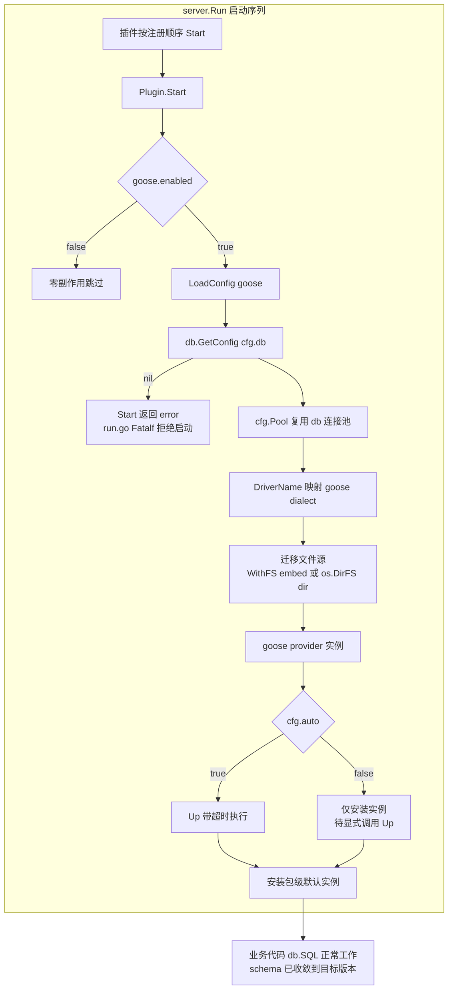

# goose 插件设计（plugins/goose）—— 数据库迁移管理

> 目标：为 aifei 应用补齐 **schema 版本化管理**（Flyway 式迁移文件管理）——迁移文件随代码走、版本表记录已应用迁移、启动时自动收敛 schema——同时**不破坏 `db` 库的零外部依赖契约**。迁移引擎选 [pressly/goose](https://github.com/pressly/goose/v3)，插件命名 `plugins/goose`（与底层引擎同名，见 §5.3）。
>
> 本文**不写实现代码的最终形态**，只给出：模块清单、接口契约（Go 签名）、配置项、迁移文件格式约定、依赖与改动点、分期建议——作为后续实现的**契约**。

---

## 目录

1. 背景与现状
2. 设计原则
3. 选型（为什么是 goose）
4. 总体架构
5. 模块结构
6. 迁移文件格式约定
7. 配置参考
8. 核心类型设计（接口契约）
9. 关键设计决策
10. 与 `db` 库、generator 的边界
11. 测试方案
12. 使用示例
13. 边界与限制（不做什么）
14. 实现步骤建议
15. 未来扩展
16. 附：与现有代码的衔接点速查

---

## 1. 背景与现状

### 1.1 问题

数据库 schema 演进目前没有任何版本化管理：

- 建表/改表 SQL 靠手工执行，开发/测试/生产三套环境的 schema **漂移**无从发现；
- 新环境建库、新成员初始化，全靠口口相传的"把这份 SQL 全跑一遍"；
- 没有版本表，无法回答"这个库现在处于哪个 schema 版本、缺哪几个变更"。

与 generator 的关系尤其值得说清：`tools/generator` 从**当前库**读元数据生成代码（`meta_reader.go`），它假定库里已经是目标 schema——但"如何把一个空库推到目标 schema、后续如何跟进增量变更"，generator 管不了。迁移插件补上的正是这一环：**migrate 收敛 schema → generator 读 schema 生成代码**，两者串成完整的开发流。

### 1.2 现有能力（已核实）

| 能力 | 载体 | 说明 |
|------|------|------|
| 多命名数据库配置 | `db/config.go:101` `InitWithID` | 应用可注册多套 db.Config（main/report/…），插件按 `db:` 取目标 |
| 取配置 | `db/config.go:120` `GetConfig` | 空 id 默认 `main`；未初始化返回 nil（插件据此 fail-fast） |
| 暴露连接池 | `db/config.go:133` `Pool()` | 已导出 `*sql.DB`，迁移引擎直接复用，**db 库无需任何改动** |
| 方言 | `db/dialect.go` | MySQL/PostgreSQL/SQLite 三方言，与 goose 支持面交集足够 |
| 插件生命周期 | `server/run.go:95` | 插件按注册顺序 `Start`、逆序 `Stop`；`Start` 出错 `log.Fatalf` 拒绝启动 |
| 插件契约套路 | `plugins/storage/plugin.go`、`plugins/cache/plugin.go` | `NewPlugin` → `LoadConfig` → `Start` 安装默认实例 → `Stop` 清理 |

关键结论：**迁移所需的全部接入点（连接池、驱动名、生命周期）都已存在**，本插件是纯增量模块，对现有模块零改动。

---

## 2. 设计原则

- **核心库零外部依赖不变**：`db` 保持零依赖；goose 只进 `plugins/goose`，用户按需 `go get`。
- **薄装配**：不做统一迁移抽象（不造 `Migrator` 接口矩阵），直接暴露 goose 的能力面；底层 provider 经 `Raw()` 逃生舱可达。
- **与既有插件一致**：沿用 storage/cache 的插件套路——配置驱动、生命周期托管、`Start` 安装包级默认实例。
- **单实例、无 Manager**（v1）：一个应用二进制默认迁移一个主库；多库目标留作扩展（§15）。
- **失败即中止**：迁移失败 → `Start` 返回 error → `run.go` `log.Fatalf`，**服务不启动**。schema 半途状态必须优先暴露，绝不带病启动。
- **默认只升不降**：`auto` 只执行 `Up`；`Down`/`Reset`/`Redo` 仅经显式 API 调用（开发期工具），生产数据永远不由插件自发销毁。
- **契约先行**：本文接口签名是后续实现的契约；实现可优化，公共 API 不偏离。

---

## 3. 选型（为什么是 goose）

| 候选 | 评价 |
|------|------|
| **pressly/goose（选定）** | library-first，原生支持 `embed.FS`（迁移文件编译进二进制）；支持 MySQL/PostgreSQL/SQLite/MariaDB 等；provider API 实例隔离、无全局状态；单依赖 MIT |
| golang-migrate | 驱动矩阵大但模块引用偏重；`V1__x.up.sql/.down.sql` 命名接近 Flyway；收益不明显 |
| Atlas | schema-first 声明式理念，与"SQL 文件管理"诉求不同路，依赖重 |
| 自研 | 版本表、失败恢复、乱序处理等细节成熟库已覆盖，不值得重造 |

goose v3 能力（已对照官方 README 核实）：

- SQL 迁移 + Go 函数迁移（v1 仅 SQL，§15）；
- 嵌入式迁移（`embed.FS`，只读，符合运行时姿态）；
- 命令面：`up` / `up-by-one` / `up-to` / `down` / `down-to` / `redo` / `reset` / `status` / `version`，插件 API 一一对应；
- 乱序迁移（`allowMissing`）、`NO TRANSACTION` 注解、`StatementBegin/End` 包裹 PL/pgSQL；
- 默认版本表 `goose_db_version`，表名可自定义；
- 官方推荐 **hybrid versioning**（开发期时间戳版本号 + 发布期 `fix` 转序号，见 §9.6）。

---

## 4. 总体架构



与 storage/cache 的结构差异：goose **无 `Manager`**（单实例），且 `Stop` 为 no-op——迁移是启动期一次性动作，不持有任何后台资源。

---

## 5. 模块结构

```
plugins/goose/
├── go.mod              # module …/aifei-go/plugins/goose
├── config.go           # Config + LoadConfig
├── goose.go            # Goose（薄封装 goose provider）+ dialect 映射 + StatusRow
└── plugin.go           # Plugin + NewPlugin/Start/Stop + 包级 API
```

### 5.1 `go.mod`

```go
module github.com/crazy-airhead/aifei-go/plugins/goose

go 1.26

require (
    github.com/crazy-airhead/aifei-go/aifei  vX.Y.Z
    github.com/crazy-airhead/aifei-go/config vX.Y.Z
    github.com/crazy-airhead/aifei-go/db     vX.Y.Z
    github.com/crazy-airhead/aifei-go/log    vX.Y.Z
    github.com/pressly/goose/v3 vX.X.X       // 唯一外部依赖（实现时取最新 v3.x）
)

replace ( … 指向 ../../ 各本地模块 )
```

### 5.2 `go.work`

新增两行：`./plugins/goose`、`./_test/goose_test`。

### 5.3 包名与 import 别名约定

插件包名 `goose`（保持目录 = 包名惯例）。底层库 `github.com/pressly/goose/v3` 的包名也叫 `goose`，**插件源码内 import 一律加别名**：

```go
goosev3  "github.com/pressly/goose/v3"
provider "github.com/pressly/goose/v3/provider"
```

用户侧只需 import 插件一次（bootstrap），建议别名 `gooseplugin`（可选，不强制——用户不用底层库时无冲突）：

```go
import gooseplugin "github.com/crazy-airhead/aifei-go/plugins/goose"
```

### 5.4 测试模块

`_test/goose_test`（`package goose_test`，black-box，仅测导出 API）。模块 `github.com/crazy-airhead/aifei-go/_test/goose_test`，依赖 `../../plugins/goose` + `../../db` + `../../config` + `../../log` + `../../aifei`，嵌入式测试数据库用 `modernc.org/sqlite`（注册名 `sqlite`，无外部服务）。

### 5.5 发布

`go get github.com/crazy-airhead/aifei-go/plugins/goose`，标签 `goose/vX.Y.Z`（符合多模块打标签约定）。CLAUDE.md 模块表追加一行（Layer=Plugin）。

---

## 6. 迁移文件格式约定

### 6.1 文件命名

```
<版本号>_<描述>.sql
```

版本号为数字前缀（`_` 前整段），goose 按版本号排序执行。推荐 **hybrid versioning**（goose 官方建议）：

- **开发期**用时间戳版本号（`goose create` 默认生成，如 `20260113103000_create_user.sql`）——团队成员并行开发不撞号；
- **发布前**跑 `goose fix` 把已定稿的迁移转成顺序号（`00001_create_user.sql` …）。

插件自身对两种风格一视同仁（都按数字版本号排序），hybrid 只是团队约定。

### 6.2 SQL 注解

每个文件**必须恰有一个 `-- +goose Up`**；`-- +goose Down` 可选（有则必须位于 Up 之后）：

```sql
-- +goose Up
CREATE TABLE sys_user (
    id       INTEGER PRIMARY KEY,
    name     TEXT NOT NULL,
    tenant_id TEXT NOT NULL DEFAULT ''
);

-- +goose Down
DROP TABLE sys_user;
```

常用注解：

| 注解 | 作用 |
|------|------|
| `-- +goose Up` / `-- +goose Down` | 升级/回退段 |
| `-- +goose NO TRANSACTION` | 本文件跳过事务（如 `CREATE DATABASE` 类无法进事务的语句） |
| `-- +goose StatementBegin` / `StatementEnd` | 包裹含分号的复杂语句（存储过程/PLpgSQL） |

### 6.3 版本表

默认 `goose_db_version`（`table:` 可改），记录版本号、是否应用、时间戳。回退与 status 都依赖它；**删除版本表等于宣告该库 schema 未知**——插件不会自动重建，`Up` 会报错拒绝。

---

## 7. 配置参考

### 7.1 `app.yml`

```yaml
goose:
  enabled: true             # false = 零副作用跳过（等价不装插件）
  db: main                  # 目标 db.Config ID（InitWithID 的 id）
  dir: migrations           # 迁移文件目录；WithFS 注入 embed.FS 时为 fsys 内子目录
  table: goose_db_version   # 版本表名
  auto: true                # Start 时自动 Up（只升不降）；生产 DBA 管控场景可 false
  timeout: 5m               # 启动期迁移执行超时（Go duration）；0 = 不限时
  verbose: false            # goose verbose（逐条打印 SQL）
  allowMissing: false       # 允许乱序迁移（开发期并行提交的场景开）
  noVersioning: false       # 不记版本表（几乎不应用）
```

### 7.2 读取策略

配置全是**扁平标量字段**，用 `config.GetStr/GetBool` 直接读，默认值就地表达；`timeout` 用 `time.ParseDuration` 解析（空/非法 = 不限时）。v1 不需要 `SubBind`。

### 7.3 零副作用降级

装了插件但 `enabled: false`：`Start` 直接返回 nil，不碰数据库、不装实例。等价于不装插件。

---

## 8. 核心类型设计（接口契约）

### 8.1 `config.go`

```go
package goose

// Config 是 plugins/goose 的配置，由 LoadConfig 从 config.Props 读取。
type Config struct {
    Enabled      bool
    DBID         string        // 目标 db.Config ID
    Dir          string        // 迁移文件目录
    Table        string        // 版本表名
    Auto         bool          // Start 时自动 Up
    Timeout      time.Duration // 启动期迁移执行超时；0 = 不限时
    Verbose      bool
    AllowMissing bool
    NoVersioning bool
}

// LoadConfig 从全局 config 读 prefix 段（空默认 "goose"）。
func LoadConfig(prefix string) *Config
```

### 8.2 `goose.go`

```go
package goose

// StatusRow 是单条迁移的状态快照（插件自有类型，不暴露底层库类型）。
type StatusRow struct {
    Version   int64
    FileName  string
    AppliedAt time.Time // 零值 = 未应用
    Applied   bool
}

// Goose 是迁移引擎实例，绑定一个 db.Config，薄封装底层 provider。
type Goose struct { /* provider、cfg、logger */ }

// New 按 cfg 构造引擎：
//  1. db.GetConfig(cfg.DBID) 为 nil → error（fail-fast：db 未初始化）
//  2. cfg.Pool() 取共享连接池（插件不 Close 池）
//  3. DriverName → goose dialect 映射（§9.7；未知驱动报错）
//  4. fsys == nil → os.DirFS(cfg.Dir)；否则 cfg.Dir 非 "." 时 fs.Sub(fsys, cfg.Dir)
//  5. provider.New(dialect, pool, fsys, 表名/logger/verbose/allowMissing 等选项)
func New(cfg *Config, fsys fs.FS, logger log.Logger) (*Goose, error)

// 以下方法与 goose CLI 命令一一对应（全部带 ctx）。
func (g *Goose) Up(ctx context.Context) error
func (g *Goose) UpByOne(ctx context.Context) error
func (g *Goose) UpTo(ctx context.Context, version int64) error
func (g *Goose) Down(ctx context.Context) error
func (g *Goose) DownTo(ctx context.Context, version int64) error
func (g *Goose) Reset(ctx context.Context) error
func (g *Goose) Status(ctx context.Context) ([]StatusRow, error)
func (g *Goose) Version(ctx context.Context) (int64, error)

// Raw 逃生舱：返回底层 goose provider（具体类型），高级用法直通底层库。
// 薄装配原则：不为底层能力做二次抽象。
func (g *Goose) Raw() *provider.Provider
```

> Redo（`down 1 + up`）底层 provider 若未直接提供，用 `Down` + `Up` 组合实现，签名照常暴露。

### 8.3 `plugin.go`

```go
package goose

// Plugin 把迁移能力接入 aifei 生命周期。
//   Start：LoadConfig → enabled? → New → auto 时带超时 Up → 安装包级默认实例
//   Stop ：no-op（迁移是启动期一次性动作，无后台资源；连接池归 db.Config 管）
//
// 编译期断言：var _ aifei.Plugin = (*Plugin)(nil)
type Plugin struct {
    prefix string
    log    log.Logger
    fsys   fs.FS  // WithFS 注入；nil = 磁盘目录
    g      *Goose
}

// NewPlugin 构造插件。logger nil 降级 log.Default()。
func NewPlugin(logger log.Logger, opts ...Option) (*Plugin, error)

func WithFS(fsys fs.FS) Option       // 嵌入迁移文件（推荐，见 §12）
func WithPrefix(prefix string) Option // 配置段前缀，空默认 "goose"

// Start 返回 error 的情形：db 未初始化 / 目录或 FS 不存在 / 迁移执行失败 / 驱动不支持。
// 任一情形 run.go 都会 log.Fatalf——迁移失败拒绝启动是特性不是缺陷（§9.5）。
func (p *Plugin) Start() error
func (p *Plugin) Stop() error

// Goose 返回 Start 构造的实例（auto=false 时用户拿它手动执行）。
func (p *Plugin) Goose() *Goose

// ---- 包级便捷 API（作用于 Start 安装的默认实例；未启动时返回错误）----

func Use() *Goose
func Up(ctx context.Context) error
func UpByOne(ctx context.Context) error
func Down(ctx context.Context) error
func Status(ctx context.Context) ([]StatusRow, error)
func Version(ctx context.Context) (int64, error)
```

---

## 9. 关键设计决策

### 9.1 用 provider API，不用 goose 全局 API

goose v3 存在两套用法：全局 API（`goose.SetDialect` + `goose.Up(db, dir)`）与 provider API（`provider.New(dialect, db, fsys)`）。**选 provider**：全局 API 有进程级共享状态（dialect、BaseFS 都是全局变量），多实例与测试并发下相互踩踏；provider 实例自带 dialect/store/文件源，天然隔离且全部方法带 `ctx`。

### 9.2 单实例、无 Manager

一个应用二进制迁移一个主库是绝对主流；`db:` 指向哪个 `db.Config` 由配置决定，已经覆盖了"多套库选一套"的场景。多库同时迁移（main + report）留作 §15 扩展（`goose.configs.<name>` 子树 + `SubBind`，套路照抄 kafka 插件）。不为没出现的需求先立 Manager。

### 9.3 事务语义与 MySQL 注意事项

- goose 默认**每个迁移文件一个事务**（成功才记版本表）；`NO TRANSACTION` 注解可跳过。
- 与 Flyway 同样的物理限制：**MySQL DDL 隐式提交**，事务只保证语义原子、不保证 DDL 回滚——迁移文件要写成"可重入"姿势（`CREATE TABLE IF NOT EXISTS` 等由团队约定）。
- goose 对 MySQL 的硬性要求（官方文档明确）：**DSN 必须带 `multiStatements=true`**（单文件多语句）与 **`parseTime=true`**（版本表时间戳解析）。应用自己拼 DSN 时容易漏——`Start` 检测到 `DriverName` 为 mysql 且 DSN 缺 `multiStatements` 时 **Warn 提示**（不阻断，因为不同驱动对参数名实现有差异）。

### 9.4 auto 语义：只升不降

`auto: true`（默认）在 `Start` 里执行 `Up`——只前进、不回退。`Down`/`DownTo`/`Reset` 只能经显式 API 调用（`p.Goose().Down(ctx)` 或包级函数），插件**任何自动路径都不会删数据**。生产环境 DBA 管控变更的场景配 `auto: false`：服务启动不碰 schema，迁移由流水线或人工执行。

### 9.5 失败即中止

迁移失败 → `Start` 返回 error → `server/run.go:96` `log.Fatalf`，进程退出。这是迁移工具的铁律：schema 处于半途状态时，应用带病启动只会把不一致放大。重启即续跑（版本表记录了断点，`Up` 幂等续传）。

### 9.6 版本号策略：hybrid versioning

goose 官方建议并内建支持：开发期用时间戳版本号（`goose create` 默认），团队成员并行开发互不撞号；发布前 `goose fix` 把定稿迁移转成顺序号（CI 里跑）。插件 v1 **不做** `create`/`fix`（它们是文件操作，属于 CLI 能力，§13/§15），但文档约定团队按 hybrid 用——插件对两种版本号一视同仁。

### 9.7 dialect 映射

`db.Config.DriverName` → goose dialect，映射表短小、未知即报错：

| db.Config.DriverName | goose Dialect |
|----------------------|---------------|
| `mysql` | DialectMySQL |
| `postgres`（含 pgx 系注册名） | DialectPostgres |
| `sqlite` / `sqlite3`（含 `modernc.org/sqlite` 注册名 `sqlite`） | DialectSQLite3 |

与 `db/dialect.go` 的三方言一致；超出三方言的驱动（TiDB/ClickHouse 等 goose 也支持）v1 不开映射，需要时加行即可。

### 9.8 插件自有类型，不漏底层库类型

公共 API 只暴露插件自有类型（`StatusRow`、`Config`），用户不 import goose 也能完成全部常规操作；底层能力经 `Raw()` 逃生舱直达 provider（高级用法自行 `go get github.com/pressly/goose/v3`）。与 pay 插件的 `Raw()` 裸体应答同一哲学：**薄装配不做统一抽象**。

### 9.9 Stop 为 no-op

迁移不产生长驻资源：provider 无连接（复用 db 共享池，**插件绝不 Close 池**）、无 goroutine。`Stop()` 返回 nil，注释说明原因。

---

## 10. 与 `db` 库、generator 的边界

| 维度 | `db` 库（核心） | `plugins/goose`（插件） | `tools/generator` |
|------|----------------|------------------------|-------------------|
| 外部依赖 | **零**（不变） | goose/v3 | 零外部依赖 |
| 职责 | 运行期数据访问 | 启动期 schema 收敛 | 从 schema 生成代码 |
| 衔接点 | `GetConfig` + `Pool()` 两个既有入口 | 只读连接池，不接管事务 | `migrate up` 之后跑，读到的即是目标 schema |

三者构成闭环：**migration 定义 schema → migrate 收敛 schema → generator 从 schema 生成类型安全代码 → 业务代码用生成的 Dao/Service 访问**。互相都不感知对方存在——插件不改 `db` 一行代码，generator 不感知迁移过程。

---

## 11. 测试方案

模块：`_test/goose_test`（`package goose_test`，black-box）。嵌入式 sqlite（`modernc.org/sqlite`），无外部服务；迁移文件用 `testing/fstest.MapFS` 或 `embed` 测试夹具构造：

| 测试 | 断言 |
|------|------|
| `TestNew_MissingDBConfig` | 未 `db.InitWithID` 就 `New` → 报错（fail-fast） |
| `TestNew_DialectMapping` | `sqlite`/`sqlite3`/`mysql`/`postgres` 映射正确；未知驱动报错 |
| `TestUp_Initial` | 两个迁移文件 → 表创建、版本表两行、`Version` 等于末文件版本号 |
| `TestUp_Incremental` | 追加第三个文件再 `Up` → 只应用新文件（前两行不变） |
| `TestUpByOne` | 逐条推进，`Version` 单步递增 |
| `TestDown` | 回退最后一个迁移 → 对应表消失、版本行删除 |
| `TestReset` | 全部回退 → 版本表清空 |
| `TestStatus` | 应用/未应用的 `StatusRow` 字段正确（Applied、AppliedAt、FileName） |
| `TestNoTransaction` | `NO TRANSACTION` 注解文件正常执行 |
| `TestWithFS_Embed` | `WithFS` 注入 `embed.FS` + `dir` 子目录 → 与磁盘目录行为一致 |
| `TestPluginStart_Auto` | `auto: true` → `Start` 后表已存在（sqlite 直查验证） |
| `TestPluginStart_AutoFalse` | `auto: false` → `Start` 后无版本表；包级 `Up` 后才有 |
| `TestPluginStart_Disabled` | `enabled: false` → `Start` 返回 nil，不建版本表 |
| `TestPluginStart_FailFast` | 迁移 SQL 有语法错误 → `Start` 返回 error |
| `TestPackageLevelAPI` | 包级 `Up/Status/Version` 委托默认实例；未启动时报错 |

> MySQL 分支的 dialect 映射靠 `TestNew_DialectMapping` 覆盖（不真连 MySQL）；MySQL DSN `multiStatements` 的 Warn 逻辑加一条单测（构造假 DSN 断言 Warn 被调用）。

---

## 12. 使用示例

### 12.1 推荐：embed + 自动迁移

```go
package main

import (
    "embed"
    "os"

    "github.com/crazy-airhead/aifei-go/aifei"
    "github.com/crazy-airhead/aifei-go/config"
    "github.com/crazy-airhead/aifei-go/db"
    gooseplugin "github.com/crazy-airhead/aifei-go/plugins/goose"
    "github.com/crazy-airhead/aifei-go/server"
)

//go:embed migrations/*.sql
var migrationsFS embed.FS

func main() {
    if err := config.Init(os.Args); err != nil {
        panic(err)
    }
    // db 先初始化（goose 插件按 db: 配置名取目标）
    if err := db.Init(cfgDriver, cfgDSN); err != nil {
        panic(err)
    }
    app := aifei.New(
        // 注册顺序在需要"表已存在"的插件（如 flow）之前——插件按注册序 Start
        aifei.WithPlugin(gooseplugin.NewPlugin(nil, gooseplugin.WithFS(migrationsFS))),
    )
    server.Run(app, ":8080") // Start 时已自动 Up，schema 已收敛
}
```

```yaml
goose:
  db: main
  dir: migrations
  auto: true
```

### 12.2 DBA 管控：不自动迁移

```yaml
goose:
  db: main
  auto: false
```

```go
// 启动后手动执行（运维端点/内部工具里调用）：
if err := gooseplugin.Up(context.Background()); err != nil {
    log.Error("migrate up failed: %v", err)
}
rows, _ := gooseplugin.Status(context.Background())
for _, r := range rows {
    fmt.Printf("%v  %s\n", r.Version, r.FileName)
}
```

### 12.3 部署姿态

- **容器/多副本**：迁移在部署流水线执行（`auto: false`），或首个副本 `auto: true` 其余 `false`—— goose 无分布式锁，多副本同时 `Up` 靠版本表行级约束兜底，并发窗口内的冲突理论上可能（§15 有锁扩展位）。
- **单体部署**：`auto: true` 即可，启动即收敛。

---

## 13. 边界与限制（不做什么）

- **不做迁移文件脚手架**（`create`）与 `fix`——文件操作属 CLI 能力，v1 用户直接用 goose CLI（`go install github.com/pressly/goose/v3/cmd/goose@latest`，指向同一套迁移文件与版本表，完全兼容）。
- **不做 checksum validate**（检测已应用文件被篡改）——goose 版本表无 checksum 列，自制需加列，留 §15。
- **不做 Flyway 命名适配**（`V<N>__<desc>.sql`）——选了 goose 就用 goose 格式，不养两套命名。
- **不做 Go 函数迁移**——v1 SQL-first；provider 已支持注册 Go 迁移，留 §15。
- **不做多库 Manager**（§15）。
- **不做分布式迁移锁**——部署纪律兜底（§12.3）。
- **不接管 `db` 事务/钩子**——迁移走裸 `*sql.DB`（goose 自管事务），与 `db` 的 HookKit 无交集。

---

## 14. 实现步骤建议

单期可交付（插件主体无前置依赖）：

1. 新建 `plugins/goose` 模块（`go.mod` + `go.work` 两行）。
2. `config.go`：`Config` + `LoadConfig`（扁平标量读法 + duration 解析）。
3. `goose.go`：dialect 映射 + `New`（五步构造，见 §8.2）+ 各迁移方法 + `StatusRow` + `Raw()`；MySQL DSN Warn 检测。
4. `plugin.go`：`Plugin` + `NewPlugin/Start/Stop` + `WithFS/WithPrefix` + 包级 API。
5. `_test/goose_test`：§11 全部用例。
6. 收尾三件套：CLAUDE.md 模块表 + 测试命令行追加；`docs/guide/` 使用页（可选）。

实现期注意：goose provider 的选项签名（表名/logger/verbose/allowMissing 等）以实现时所取 v3.x 的实际 API 为准校准；本文契约约束的是**插件自身的公共 API**，不锁定底层调用细节。

---

## 15. 未来扩展（非本期）

| 扩展 | 思路 | 触发条件 |
|------|------|----------|
| 多库 Manager | `goose.configs.<name>.*` 子树 + `SubBind`（照抄 kafka 插件）+ `Use(name)` | 应用真出现多库迁移 |
| checksum validate | 版本表加 `checksum` 列，`Up` 前比对 sha256，不一致报错 | 团队规模大、迁移文件被手改的事故出现 |
| 分布式迁移锁 | MySQL `GET_LOCK` / postgres `WithSessionLock`（上游已支持） | 多副本同时 `auto: true` 成为常态 |
| Go 函数迁移 | provider 注册 Go 迁移函数（数据订正类场景） | 出现 SQL 难以表达的复杂变更 |
| 迁移脚手架 | `tools/` 下新 CLI：create/fix（复用 goose CLI 或薄封装） | 团队嫌装 goose CLI 麻烦 |
| seeds 数据种子 | goose seed 目录支持（初始化字典数据） | 出现跨环境一致的种子数据需求 |

---

## 16. 附：与现有代码的衔接点速查

| 衔接点 | 位置 | 说明 |
|--------|------|------|
| 取目标库 | `db/config.go:120` `GetConfig` | 空 id 默认 main；nil 即 fail-fast |
| 连接池 | `db/config.go:133` `Pool()` | 共享池，插件不 Close |
| 驱动名 | `db.Config.DriverName` | dialect 映射输入（§9.7） |
| Plugin 接口 | `aifei/plugin.go` | `Start()`/`Stop()` 生命周期 |
| 插件启动序 | `server/run.go:95` | 按注册顺序 Start；失败 `log.Fatalf`（96 行） |
| 插件套路参考 | `plugins/storage/plugin.go`、`plugins/cache/plugin.go` | `NewPlugin/Start/Stop` + `var _ aifei.Plugin` |
| 配置读取 | `config.GetStr/GetBool` | 扁平标量读法 |
| 多实例配置先例 | `plugins/kafka/config.go:100` `SubBind` | §15 多库扩展时照抄 |
| 测试约定 | `_test/db_test` | sqlite 嵌入式 + black-box |
| goose | `github.com/pressly/goose/v3` | provider API；CLI 与本插件共用迁移文件与版本表 |
| 相关文档 | `docs/arch/multi-table-mapping.md` | db 侧元数据能力（与迁移无耦合，列出备查） |
