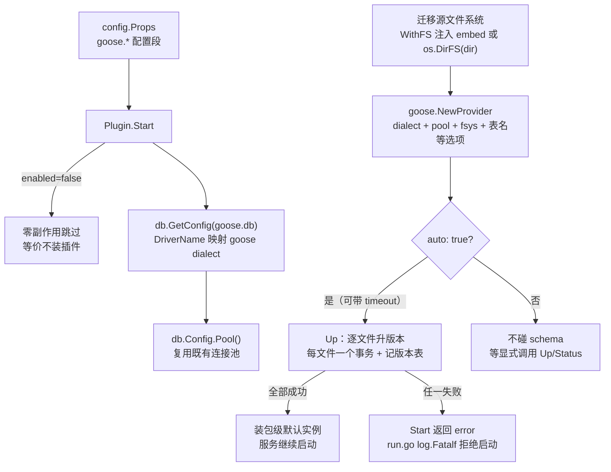

# Aifei-Go Goose 插件：数据库迁移管理

> **启动即收敛 schema，失败即拒绝启动。** 基于 [pressly/goose/v3](https://github.com/pressly/goose/v3) 的 provider API：`Start` 时把数据库结构升到最新版本，每个迁移文件一个事务并记录版本表；迁移失败服务直接退出，重启幂等续跑。与 `db` 库零改动衔接，与 goose CLI 完全兼容。

---

## 1. 背景与定位

应用演进必然伴随 schema 变更：加表、加列、订正数据。手工执行 SQL 脚本的痛点——环境之间漂移、无法追溯"哪个版本执行过哪些变更"、新环境搭建靠口口相传——正是迁移工具要解决的。

`plugins/goose` 是基于 goose（Go 生态事实标准的迁移工具之一）封装的数据库迁移插件：

- **是什么**：实现 `aifei.Plugin` 的迁移门面，把 schema 收敛挂进 aifei 启动生命周期
- **解决什么**：迁移文件进代码库、版本表记录进度、启动时自动升到最新、失败拒绝带病启动
- **依赖**：内部模块 `aifei` / `config` / `db` / `log`；外部库 `github.com/pressly/goose/v3`（唯一外部依赖，只进插件模块）
- **不解决什么**：迁移文件脚手架（`create`/`fix`）、checksum 校验、分布式迁移锁——见[第 9 节](#_9-边界与逃生口)

> 设计契约与决策记录：[goose 插件（数据库迁移）](../arch/goose-plugin.md)。

---

## 2. 核心概念与数据流

插件的核心设计是**薄装配**：goose provider 负责全部迁移语义（解析注解、执行、事务、版本表），插件只做四件事——读配置、找 `db.Config`、接文件源、挂生命周期。



关键类型清单：

| 类型 | 职责 |
|------|------|
| `Config` | 插件配置（`LoadConfig` 从 `goose.*` 段读取） |
| `Goose` | 迁移引擎实例，绑定一个 `db.Config`，薄封装底层 provider |
| `StatusRow` | 单条迁移的状态快照（插件自有类型，不暴露底层库类型） |
| `Plugin` | `aifei.Plugin` 实现：Start 收敛 schema，Stop no-op |

---

## 3. 关键 API

### 3.1 `Goose` 实例方法

方法与 goose CLI 命令一一对应，全部带 `ctx`：

```go
func (g *Goose) Up(ctx context.Context) error                   // 应用全部待执行迁移
func (g *Goose) UpByOne(ctx context.Context) error              // 只应用下一个
func (g *Goose) UpTo(ctx context.Context, version int64) error  // 应用到指定版本
func (g *Goose) Down(ctx context.Context) error                 // 回滚最近一个
func (g *Goose) DownTo(ctx context.Context, version int64) error // 回滚到指定版本
func (g *Goose) Reset(ctx context.Context) error                // 全部回滚（等价 DownTo 0）
func (g *Goose) Status(ctx context.Context) ([]StatusRow, error) // 迁移状态清单
func (g *Goose) Version(ctx context.Context) (int64, error)      // 当前数据库版本
func (g *Goose) Raw() *goosev3.Provider                          // 逃生舱（见第 9 节）
```

`StatusRow` 携带版本号、文件名、应用时间与是否已应用，供运维端点渲染迁移清单。

### 3.2 包级便捷 API

`Plugin.Start` 成功后安装包级默认实例，业务/运维代码直接用顶层函数：

```go
goose.Use()                                  // 取默认实例（未启动返回 nil）
goose.Up(ctx) error
goose.UpByOne(ctx) error
goose.Down(ctx) error
goose.Status(ctx) ([]StatusRow, error)
goose.Version(ctx) (int64, error)
```

未启动（或 `enabled: false`）时调用返回错误而非 panic——与 [kafka 插件](kafka.md)的包级默认语义一致。

### 3.3 构造

```go
// 直接构造（不经配置文件）：
g, err := goose.New(cfg *Config, fsys fs.FS, logger log.Logger)

// 经生命周期（推荐）：
p, err := goose.NewPlugin(logger, goose.WithFS(migrationsFS), goose.WithPrefix("goose"))
```

`WithFS` 注入 `embed.FS` 是推荐姿势——迁移文件编译进二进制，容器部署零挂载；不注入则读磁盘 `dir` 目录。配置 `dir` 在注入 FS 时表示 **FS 内子目录**（如 `embed` 的 `testdata/migrations`）。

---

## 4. 迁移文件格式

goose 用 SQL 注解声明方向，一个文件同时包含升与降：

```sql
-- +goose Up
CREATE TABLE users (
    id INTEGER PRIMARY KEY,
    name TEXT NOT NULL
);

-- +goose Down
DROP TABLE users;
```

- **文件命名**：数字前缀定版本号——`00001_create_users.sql`、`00002_add_email.sql`
- **版本策略（hybrid versioning）**：开发期用时间戳版本号（`20260101120000_x.sql`）避免并行提交撞号；发布前用 goose CLI 的 `goose fix` 统一转顺序号。团队约定一致即可
- **事务**：每个迁移文件一个事务，成功才记版本表；`-- +goose NO TRANSACTION` 注解可跳过（大批量数据订正时用）
- **多语句**：一个 Up 段可以有多条语句

**MySQL 注意**（官方要求）：DSN 必须带 `multiStatements=true` 与 `parseTime=true`。插件检测到 mysql 驱动而 DSN 缺 `multiStatements` 时会在启动日志 Warn 提示（不阻断——不同驱动参数名实现有差异）。另外 MySQL DDL 隐式提交，事务只保证语义原子：迁移文件要写成可重入姿势（如 `CREATE TABLE IF NOT EXISTS`），这是团队纪律而非工具能强制的。

版本表默认名 `goose_db_version`（可配 `table`），记录每个已应用版本；goose 建表时会插入一条 version 0 的种子行。

---

## 5. 生命周期：auto 与 fail-fast

### 5.1 `auto: true`（默认）：启动即收敛

`Start` 里执行 `Up`——**只升不降**。任何自动路径都不会删数据；`Down`/`DownTo`/`Reset` 只能经显式 API 调用。`timeout` 限定启动期迁移的执行时长（空/非法 = 不限时），避免一个卡死的迁移把启动挂死。

### 5.2 失败即拒绝启动

迁移失败 → `Start` 返回 error → `server/run.go` 的 `log.Fatalf`，进程退出。这是迁移工具的铁律：schema 处于半途状态时，应用带病启动只会把不一致放大。重启即续跑——版本表记录了断点，`Up` 幂等。

### 5.3 `auto: false`：DBA 管控

生产环境由 DBA/流水线管控变更时配置 `auto: false`：服务启动不碰 schema，迁移由流水线执行或经内部运维端点调 `goose.Up(ctx)` 手动触发。

### 5.4 多副本部署姿态

goose 无分布式锁。单体部署 `auto: true` 即可；多副本场景建议迁移在部署流水线执行（`auto: false`），或首个副本 `auto: true` 其余 `false`——版本表行级约束能兜底大部分并发窗口，但不承诺互斥。

---

## 6. 配置

### 完整 YAML

```yaml
goose:
  enabled: true             # false = 零副作用跳过（等价不装插件）
  db: main                  # 目标 db.Config ID（db.InitWithID 的 id）
  dir: migrations           # 迁移文件目录；WithFS 注入时为 FS 内子目录
  table: goose_db_version   # 版本表名
  auto: true                # Start 时自动 Up（只升不降）
  timeout: 5m               # 启动期迁移执行超时；0 = 不限时
  verbose: false            # goose verbose（逐条打印 SQL）
  allowMissing: false       # 允许乱序迁移（开发期并行提交场景开）
  noVersioning: false       # 不记版本表（几乎不应用）
```

### 默认值速查

| 键 | 默认值 | 说明 |
|----|--------|------|
| `enabled` | `true` | 关掉后 Start 直接返回，不碰数据库 |
| `db` | `main` | 指向 [db](db.md) 的命名配置 |
| `dir` | `migrations` | 磁盘目录或 FS 子目录 |
| `table` | `goose_db_version` | 与 goose CLI 默认一致，两边互通 |
| `auto` | `true` | 启动即收敛 |
| `timeout` | 空（不限时） | `time.ParseDuration` 解析 |
| `verbose` / `allowMissing` / `noVersioning` | `false` | 透传 goose 选项 |

配置全是扁平标量，`config.GetStr/GetBool` 直读——配置加载机制见 [config.md](config.md)。

---

## 7. 使用示例

### 7.1 推荐：embed + 自动迁移

```go
package main

import (
    "embed"
    "os"

    "github.com/crazy-airhead/aifei-go/aifei"
    "github.com/crazy-airhead/aifei-go/config"
    "github.com/crazy-airhead/aifei-go/db"
    gooseplugin "github.com/crazy-airhead/aifei-go/plugins/goose"
    "github.com/crazy-airhead/aifei-go/server"
)

//go:embed migrations/*.sql
var migrationsFS embed.FS

func main() {
    if err := config.Init(os.Args); err != nil {
        panic(err)
    }
    // db 先初始化——goose 插件按 goose.db 配置名取目标连接池
    if err := db.Init(cfgDriver, cfgDSN); err != nil {
        panic(err)
    }
    app := aifei.New(
        // 需要表已存在的插件（如 flow）要注册在 goose 之后——插件按注册序 Start
        aifei.WithPlugin(gooseplugin.NewPlugin(nil, gooseplugin.WithFS(migrationsFS))),
    )
    server.Run(app, ":8080") // Start 时已自动 Up，schema 已收敛
}
```

```yaml
goose:
  db: main
  dir: migrations
  auto: true
```

### 7.2 DBA 管控：不自动迁移

```yaml
goose:
  db: main
  auto: false
```

```go
// 启动后手动执行（运维端点/内部工具里调用）：
if err := gooseplugin.Up(context.Background()); err != nil {
    log.Error("migrate up failed: %v", err)
}
rows, _ := gooseplugin.Status(context.Background())
for _, r := range rows {
    fmt.Printf("%v  %s\n", r.Version, r.FileName)
}
```

### 7.3 与 goose CLI 互操作

插件与 CLI 指向同一套迁移文件、同一张版本表，完全兼容：

```bash
go install github.com/pressly/goose/v3/cmd/goose@latest
goose -dir migrations sqlite3 ./app.db status
goose -dir migrations sqlite3 ./app.db up
goose -dir migrations fix   # 发布前时间戳版本转顺序版本
```

---

## 8. 与 db、generator 的闭环

迁移工具不是孤岛，它与框架的另外两块构成一条链：

| 维度 | [db](db.md)（核心） | plugins/goose（插件） | [generator](generator.md) |
|------|--------------------|-----------------------|---------------------------|
| 外部依赖 | **零** | goose/v3 | 零 |
| 职责 | 运行期数据访问 | 启动期 schema 收敛 | 从 schema 生成代码 |
| 衔接点 | `GetConfig` + `Pool()` 两个既有入口 | 只读连接池，不接管事务 | migrate 之后跑，读到的即是目标 schema |

**migration 定义 schema → 插件收敛 schema → generator 从 schema 生成类型安全 Dao → 业务用生成的代码访问**。三者互不感知：插件不改 `db` 一行代码，generator 不感知迁移过程。

---

## 9. 边界与逃生口

### 9.1 `Raw()` 逃生舱

高级用法（session locker、注册 Go 函数迁移、排除指定版本等）直通底层 provider，插件不做二次抽象——与 [kafka 插件](kafka.md)的 `KgoClient()` 同一哲学：

```go
p := g.Raw() // *goosev3.Provider
```

### 9.2 不做什么

- **迁移脚手架**（`create`/`fix`）——直接用 goose CLI
- **checksum 校验**——goose 版本表无 checksum 列
- **Flyway 命名适配**——选了 goose 就用 goose 格式
- **Go 函数迁移**——v1 SQL-first（provider 已支持，走 `Raw()` 可用）
- **多库 Manager / 分布式锁**——单库单实例为绝对主流；部署纪律兜底

这些在架构文档的扩展清单里都有触发条件与思路，出现了再加。

---

## 10. 模块结构

```
plugins/goose/
├── go.mod              # 唯一外部依赖 pressly/goose/v3
├── config.go           # Config + LoadConfig（扁平标量 + duration 解析）
├── goose.go            # Goose + dialect 映射 + StatusRow + MySQL DSN 检测
└── plugin.go           # Plugin 生命周期 + 包级 API
```

测试在 `_test/goose_test`（嵌入式 sqlite，无外部服务），覆盖构造 fail-fast、dialect 映射、升降级、状态、NO TRANSACTION、embed 注入与插件生命周期各分支。

---

## 11. 总结

1. **薄装配**：goose provider 承载全部迁移语义，插件只做配置→连接→文件源→生命周期四步粘合
2. **启动即收敛**：`auto: true` 时 Start 执行 Up，只升不降；失败拒绝启动，重启幂等续跑
3. **零改动衔接 db**：只经 `GetConfig` + `Pool()` 两个既有入口取共享连接池，`db` 库不感知迁移
4. **CLI 完全兼容**：同一套文件、同一张版本表，开发期 CLI 与插件混用无隔阂
5. **80/20 逃逸口**：常规路径包级 API 三行搞定；高级语义走 `Raw()` 直通底层

---

### 延伸阅读

- 设计契约与决策记录：[goose 插件（数据库迁移）](../arch/goose-plugin.md)
- 框架与 `aifei.Plugin` 生命周期：[core.md](core.md)
- 数据库访问与命名配置：[db.md](db.md)
- schema → 代码生成：[generator.md](generator.md)
- goose 官方文档：<https://pressly.github.io/goose/>
